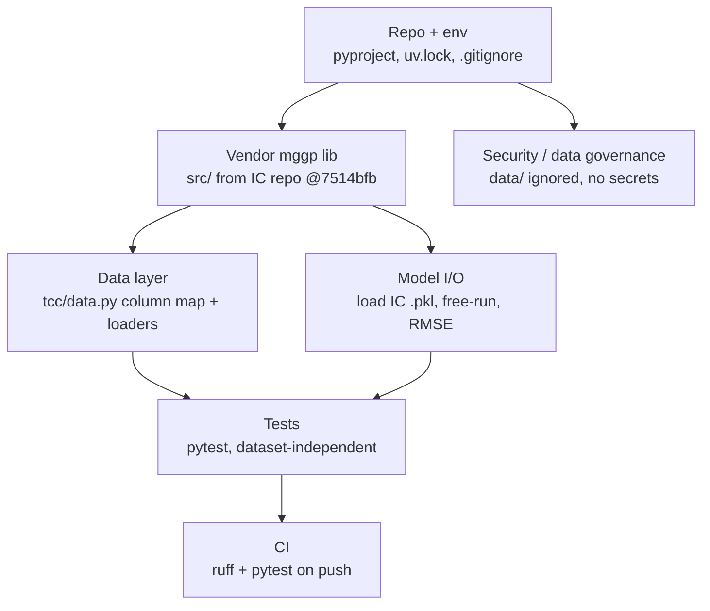
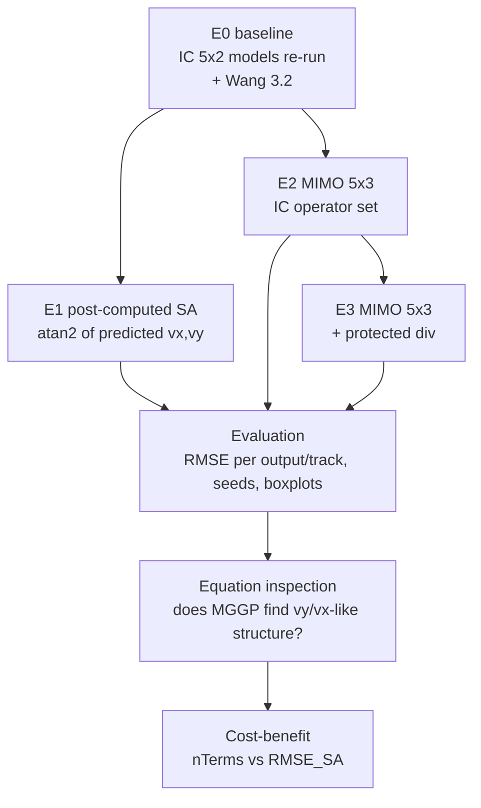
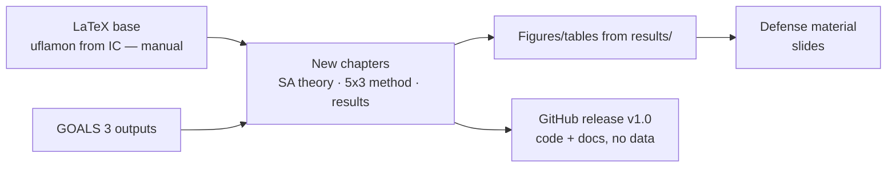
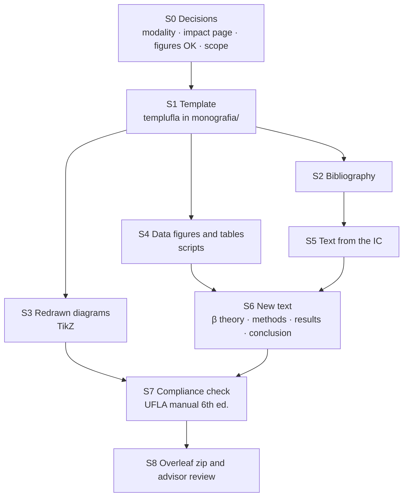
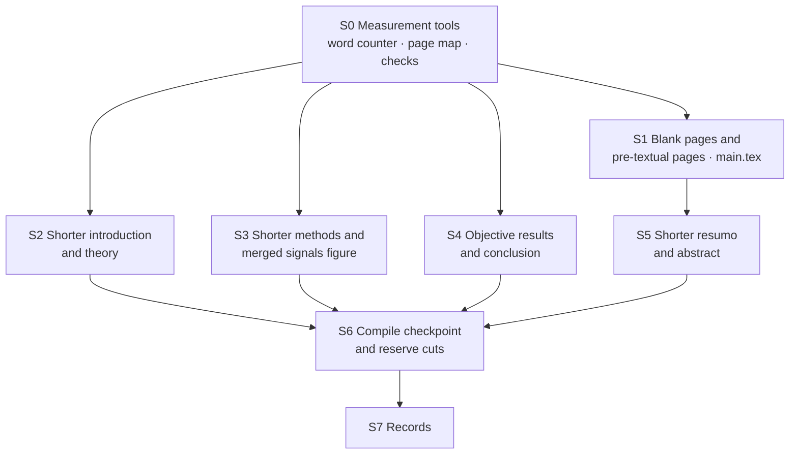

# GOALS.md — TCC: Slip-angle estimation as a third MIMO output of the IC's MGGP virtual sensor

> **Status: GOALS 1 done (2026-09-21).** The Wang/Jilin database is now in **`Database/`** (gitignored; the folder
> name follows the IC repo, not the `data/` this plan originally said — read `data/` as `Database/` below). The IC
> repo @ `7514bfb` and the T19/T48 `.pkl` models are also local at `D:\ProjetosPessoais\IC\TreinamentoMGGP_2_0\`.
> Nothing is blocked on the dataset any more.
>
> Context: [`CONTEXTO_IC.md`](CONTEXTO_IC.md) (Portuguese summary of the IC this TCC extends).
> Repo: https://github.com/alexmiguel011014-stack/tcc.git · Stack decided by the user: **Python + original `mggp` lib** (DEAP + NumPy).

## Fixed facts `/execgoals` must not re-derive

| Fact | Value | Source |
|---|---|---|
| IC repo (lib + trained models) | https://github.com/alexmiguel011014-stack/TreinamentoMGGP_2_0.git @ `7514bfb` | verified 2026-09-20 |
| Lib location inside IC repo | `src/{base.py, mggp.py, predictors.py, crossings.py, mutations.py}`; imports are absolute `from src.…` | read |
| Lib supports N outputs | `nOutputs = outputs.shape[1]`; MIMO mode auto-selected when `nInputs>1 and nOutputs>1`; `main.py` history shows a 2×3 F16 run | `src/mggp.py:90-104` |
| Operators available in lib | `mul`, `sign`, `subtraction`, `add` — **no division** | `src/base.py:73-78` |
| FROE pruning | `_froe_pruning_mimo` exists in current `src/mggp.py:843`; IC report says it was not usable in MIMO — treat as unverified | read |
| Excel layout | `pd.read_excel(path, header=None)`, 24 float columns, no header; **u = cols [14, 2, 22, 23, 11]** (ax_nobias, acc_y raw, wheel front, wheel rear, YawRate raw); **vx = col 18 (vx_smooth), vy = col 17 (vy_smooth)**. Full legend in `docs/column_inventory.md`; slip angle: col 3 `Sideslip_angle` (deg, raw), col 19 `SA_smooth` (rad). Wheel speeds are rad/s (r_eff ≈ 0.30 m), not m/s. | MATLAB export legend + `TrainingMGGP_LOOP.ipynb` |
| Pre-processing in the final IC grid | none — raw values, no offset, no scaler (`return u, y_raw`) | `TrainingMGGP_LOOP.ipynb` |
| Runs per config in the IC | 10 independent evolutions per (nDelays, nTerms, maxH) → `modelo_rmse_1..10.pkl`; no fixed seeds | notebook + repo tree |
| IC fixed params | generations 300, populationSize 300, k 300, MShooting train / FreeRun test, mutationRate 0.3, crossoverRate 0.8, elitePercentage 10, operators `['add','subtraction','mul']`, froe_mode False | IC report Tab. 3.1 |
| IC anchor models | **T19** (RESULTADOS-2/Treinamento_19, `modelo_rmse_6.pkl`, nDelays [1,2,5,10], nTerms 3, maxH 5, RMSE 0.2239) · **T48** (RESULTADOS-3/Treinamento_48, nDelays [1,2,5,10,25,50], nTerms 7, maxH 6, RMSE 0.2121) | IC report |
| Tracks | Wang 2.1 train · 2.2 validation · 3.1 test A · 8.1 test B · **3.2 unused in IC → available as test C** | IC report |
| Slip angle definition | β = atan2(v_y, v_x). **GOALS 1 verdict: computed** — col 3 = atan2(vy 10, vx 9) to 1e-16; col 19 = ~21-sample moving average of col 3; on wang31/81/32 `vy_smooth` carries a +0.30…+0.37 m/s constant offset that SA was never recomputed for. Third output for GOALS 3 := atan2(col 17, col 18), not col 19. | `docs/slip_angle_provenance.md` |
| Local toolchain | Python 3.12.10, `uv` installed, `gh` CLI authenticated, `pdftotext` available | checked |
| Dataset licensing | Jilin University partnership data — **never commit `Database/` to the public repo** (`.gitignore` in place) | user context |

---

## GOALS 1 — Research: is the slip angle in the Wang database measured or computed?


Suggested: sonnet · medium — small numeric script, but the answer decides the whole experiment design in GOALS 3.

- [x] Question (precise): "For each of the 5 Wang tracks, does any column equal `atan2(vy, vx)` (rad or deg, ±sign) to within floating-point/rounding tolerance? If yes → SA is *computed* from vx, vy and carries no independent information. If the closest column differs by more than sensor-noise level → SA is *measured* (GPS/INS) and is a legitimate independent third output." — done when: this sentence is the first line of `docs/slip_angle_provenance.md`.
- [x] `(manual)` Copy `wang21dv_bic_MGGP.xlsx`, `wang22dv_bic_MGGP.xlsx`, `wang31dv_bic_MGGP.xlsx`, `wang32dv_bic_MGGP.xlsx`, `wang81dv_bic_MGGP.xlsx` into `Database/` on the machine that will run this — done when: `python -c "import glob; print(sorted(glob.glob('Database/wang*.xlsx')))"` lists all five. *(done 2026-09-21)*
- [x] Column inventory: `scripts/inspect_columns.py` prints, per track, column index, dtype, min/max/mean/std, and the first 3 rows for **every** column (not only the 7 used by the IC) → `docs/column_inventory.md` — done when: the file exists for all 5 tracks and the 7 known columns match the values the IC used (vx in col 18 has magnitude ~m/s, yaw rate col 11 ~rad/s).
- [x] Provenance check: `scripts/check_slip_angle.py` computes `beta_rad = atan2(vy, vx)`, `beta_deg`, `vy/vx`, and `-beta_*`; for every column not in `{2, 11, 14, 17, 18, 22, 23}` reports RMSE, max|Δ|, Pearson r against each candidate; picks the best column; classifies **computed** if max|Δ| < 1e-3 rad (or < 0.06°) on all 5 tracks, else **measured/independent** — done when: the script exits 0, writes `docs/slip_angle_provenance.md` (table per track + verdict) and `docs/fig/slip_angle_overlay_<track>.png` (SA column vs atan2 over time + residual).
- [x] Edge cases recorded in the same doc: samples where |vx| < 0.5 m/s (atan2 ill-conditioned at standstill), how many, and how the SA column behaves there (NaN? zero? saturates?) — done when: the doc has a "low-speed behaviour" section with counts per track.
- [x] Decision written into GOALS 3 header (`Verdict: computed | measured`) and mirrored in the memory file `tcc-slip-angle-direction` — done when: both mention the verdict and the chosen SA column index.

---

## GOALS 2 — Build: reproducible project scaffold around the original `mggp` lib



Suggested: sonnet · medium — mostly mechanical, but vendoring the lib and reproducing IC numbers needs care.

### Repo & environment
- [x] `git init` on `main`, remote `origin = https://github.com/alexmiguel011014-stack/tcc.git`, first commit contains `CONTEXTO_IC.md` + `GOALS.md` — done when: `git remote -v` shows origin and `git log` has the commit. *(done in this session — verify only)*
- [x] `.gitignore`: `Database/`, `results/`, `*.pkl`, `*.png` under `results/`, `.venv/`, `__pycache__/`, `.pytest_cache/`, `.ruff_cache/`, `graphify-out/`, `repomix-output.xml`, `.env` — done when: `git check-ignore data/wang21dv_bic_MGGP.xlsx results/x.pkl` prints both paths.
- [x] `pyproject.toml` (project `tcc`, `requires-python = ">=3.12,<3.13"`) with runtime deps pinned to the IC's `requirements.txt` versions: `deap==1.4.3`, `numpy==2.2.6`, `pandas==2.3.3`, `scipy==1.15.3`, `scikit-learn==1.7.2`, `matplotlib==3.10.8`, `numba==0.64.0`, `tqdm==4.67.3`, `joblib==1.5.3`, plus `openpyxl` (required by `pd.read_excel`, missing from the IC list), `dill` (the IC serialised models with it); dev deps `pytest`, `ruff` — done when: `uv sync` completes and `uv run python -c "import deap, numpy, pandas, openpyxl, dill; print('ok')"` prints ok.
- [x] `uv.lock` committed; `requirements.txt` exported via `uv export --no-dev > requirements.txt` for the lab PC without uv — done when: both files exist and `pip install -r requirements.txt` in a fresh venv succeeds (`(manual)` on the other PC).
- [x] `README.md`: what the TCC is (1 paragraph), how to get the data (not included — where to ask), `uv sync`, how to run the SA check, how to run an experiment, how to run tests — done when: a reader can execute GOALS 1's script from the README alone.
- [x] `CLAUDE.md` for this repo: column map, "never commit data/", the IC anchors (T19/T48), the operator-set caveat, and that `src/` is vendored (edit only via documented patches) — done when: the file exists and each fact above is in it.

### Vendor the `mggp` library
- [x] Copy `src/` (5 files) from `TreinamentoMGGP_2_0` @ `7514bfb` into `src/` at this repo's root, keeping the `from src.…` absolute imports untouched — done when: `uv run python -c "from src.mggp import MGGP; print(MGGP)"` works from the repo root.
- [x] `src/VENDORED.md`: source repo, commit hash, date, list of local patches (initially "none") — done when: the file exists; every later edit to `src/` adds a line here.
- [ ] Smoke test `tests/test_lib_smoke.py`: synthetic MIMO NARX system (2 inputs, 3 outputs, N=400, generated with a known polynomial + noise), `MGGP(..., generations=3, populationSize=20, nDelays=[1,2], nTerms=2, maxHeight=3, operators=['add','subtraction','mul'])`, `run()`, then `predict('FreeRun')` returns arrays of shape (N−lag, 3) — done when: `uv run pytest tests/test_lib_smoke.py` passes in < 60 s without any dataset (proves the 5×3 path works before real data exists).

### Data layer
- [ ] `tcc/data.py`: constants `INPUT_COLS = [14, 2, 22, 23, 11]`, `VX_COL = 18`, `VY_COL = 17`, `SA_COL = None` (set by GOALS 1), `TRACKS = {"wang21": "train", "wang22": "val", "wang31": "testA", "wang81": "testB", "wang32": "testC"}`; `load_track(name, outputs=("vx","vy")) -> (u, y, df)`; raises a clear `FileNotFoundError` naming `data/` when missing — done when: `tests/test_data.py` (using a 30-row synthetic `.xlsx` written into `tmp_path` with 24 columns) asserts shapes (N,5)/(N,2)/(N,3) and the column mapping.
- [ ] `tcc/metrics.py`: `rmse(y_true, y_pred)` per column, `slip_angle(vx, vy) -> atan2`, `sa_from_predictions(y_pred_2col)`; degrees helper — done when: unit tests with hand-computed values pass (e.g., `slip_angle(1, 1) == pi/4`).

### Model I/O (reproduce the IC before extending it)
- [ ] `tcc/models.py`: `load_ic_model(path)` (dill/pickle, same loader the IC notebooks used), `free_run(model, u, y, k=300) -> y_pred`, `describe(model) -> str` (genes + coefficients, GPTIPS-style like `VALIDACAO_FAST.ipynb`) — done when: `tests/test_models.py` round-trips a model produced by the smoke test.
- [x] *(2026-10-28: read in place from `D:\ProjetosPessoais\IC\TreinamentoMGGP_2_0\` by `scripts/reproduce_ic.py`; T48 = `modelo_rmse_9.pkl`, T19 = `modelo_rmse_6.pkl`, no copy needed)* `(manual)` Fetch the two anchor models from the IC repo into `results/ic_anchors/`: `RESULTADOS-2/Treinamento_19/TRAINING/modelo_rmse_6.pkl` and the best of `RESULTADOS-3/Treinamento_48/TRAINING/modelo_rmse_*.pkl` (pick by `relatorio_validacao_rmse.csv`) — done when: both files exist locally (`gh api …/contents/<path>` or clone with `--filter=blob:none` + sparse checkout).
- [x] *(2026-10-28: T48 0.2121, T19 0.2240 on the IC's 4 tracks; the pickled `_funcs` are stale, so the script recompiles each model with an `MGGP` pset of the same nDelays)* `scripts/reproduce_ic.py`: free-run T19 and T48 on Wang 2.2 / 3.1 / 8.1 (+ 3.2 for the first time) and print RMSE vx/vy — done when: T19 reproduces 0.2239 ± 0.005 overall and T48 0.2121 ± 0.005 (tolerance for float/loader differences); any larger gap is investigated before GOALS 3 starts.

### Tests, lint, CI
- [x] `ruff` configured in `pyproject.toml` (`line-length = 100`, `select = ["E","F","I","B"]`, `exclude = ["src"]` — the vendored lib is not reformatted) — done when: `uv run ruff check .` is clean.
- [ ] `uv run pytest` runs the dataset-independent suite (`test_lib_smoke`, `test_data`, `test_models`, `test_metrics`); dataset tests are marked `@pytest.mark.dataset` and auto-skip when `data/` is absent — done when: the full run passes on this machine (no data) with the dataset tests reported as skipped, not failed.
- [ ] `.github/workflows/ci.yml`: `uv sync`, `ruff check`, `pytest -m "not dataset"` on push/PR, Python 3.12, Ubuntu — done when: the first push after this item shows a green run in `gh run list`.

### Security / data governance
- [ ] `(manual)` Decide with the advisor whether the public repo may host derived artefacts (plots, CSV of predictions) from the Jilin data; default = **no raw data, aggregated results only** — done when: the decision is written in `README.md` ("Data" section) and `CLAUDE.md`.
- [ ] Pre-commit guard: `scripts/check_no_data.sh` (fails if any `data/*.xlsx` or `*.pkl` > 1 MB is staged) wired via `.git/hooks/pre-commit` (`(manual)` install step documented in README) — done when: staging a dummy `data/x.xlsx` is rejected.
- [ ] `uv run pip-audit` (or `uv tool run pip-audit`) shows no critical CVE in the pinned set; if `numpy 2.2.6`/`scikit-learn 1.7.2` are flagged, record the exception in `CLAUDE.md` (pinned for parity with the IC) — done when: the audit output is saved to `docs/audit.txt`.

---

## GOALS 3 — Experiments: 5 inputs × 3 outputs (v_x, v_y, β) vs. post-computed slip angle

`Verdict from GOALS 1: computed — SA column: 19 (SA_smooth, rad; raw = col 3, deg)`. β for training/evaluation := **atan2(col 17, col 18)**; see `docs/slip_angle_provenance.md` §Verdict for why col 19 is not used as-is, and §Part D for the a_x/a_y input-choice question to settle with the advisor before E2.



Suggested: opus · high — experimental design with a data-dependent fork, multi-hour training runs that cannot be cheaply retried, and results that need interpretation, not just numbers.

### Design (settle before any training)
- [ ] Design note `docs/experiment_design.md` covering: (i) the two arms **A = 5×2 + atan2(v̂y, v̂x)** and **B = 5×3 MIMO**, (ii) why B can only beat A if SA is *measured* or if the extra output regularises vx/vy jointly (state the hypothesis explicitly), (iii) SA units for training (rad — same scale issue as vy vs vx; document whether to train on deg to balance magnitudes and convert back), (iv) seeds: **5 independent runs per config** (IC used 10; halve to fit the deadline, `(manual)` confirm with advisor), (v) tracks: train Wang 2.1, validate 2.2, test 3.1, 8.1, **3.2** — done when: the note exists and the advisor has seen it `(manual)`.
- [ ] Config anchors: reuse **T19** and **T48** hyper-parameters exactly (same nDelays, nTerms, maxH, 300/300/k=300, rates) so any change is attributable to the third output — done when: `experiments/configs/{t19,t48}_5x3.json` exist and diff only in `outputs` vs the IC's `parametros_utilizados.csv`.
- [ ] Runtime budget: time one T19-config 5×3 run end-to-end and record it in the design note; if > 6 h, `(manual)` decide between fewer seeds, `generations=150`, or running on the lab PC — done when: the measured wall time is written down.

### Runs
- [x] *(2026-10-28: done by `scripts/reproduce_ic.py`, which writes `results/e0/predictions_<model>_<track>.csv` and `results/e0/rmse_ic.csv` for all 5 tracks incl. Wang 3.2)* **E0** `scripts/run_e0_baseline.py`: free-run T19/T48 on all 4 held-out tracks, save `results/e0/predictions_<model>_<track>.csv` — done when: RMSE matches GOALS 2's reproduction item.
- [x] *(2026-10-28: done by `scripts/reproduce_ic.py` → `results/e1/rmse_sa.csv`, reference = atan2 of the measured pair)* **E1** `scripts/run_e1_postsa.py`: `β̂ = atan2(v̂y, v̂x)` from E0 predictions; RMSE_β (rad and deg) per track vs the SA column (or vs atan2 of measured vx, vy if SA is computed) — done when: `results/e1/rmse_sa.csv` exists with one row per (model, track).
- [x] *(2026-10-28: runs in 16 s; c = 0.2988, sign s = −1 chosen on Wang 2.1; `results/e1b/rmse_beta_cinematico.csv`)* **E1b** (decision 5.0.4 a, 2026-10-28) `scripts/run_e1b_cinematico.py`: kinematic β estimator as a
  physics-based reference, no training.
  - Files: `scripts/run_e1b_cinematico.py` (new).
  - Change: a PEP 723 script (deps `numpy`, `pandas`, `openpyxl`; `sys.stdout.reconfigure(encoding="utf-8")`). For
    each of the 5 tracks in `Database/`: read with `pd.read_excel(header=None)`; set $T = 1/200$ s; take
    $a_y$ = col 2, $\dot\psi$ = col 11, $\hat v_x = c\,u_4$ with $u_4$ = col 23 and $c$ = the least-squares ratio of
    col 18 to col 23 **fitted on Wang 2.1 only**; integrate $\hat\beta[k] = \hat\beta[k-1] + T\,(a_y[k-1]/\hat v_x[k-1]
    - \dot\psi[k-1])$ in rad from $\hat\beta[0] = 0$; where $\hat v_x < 1$ m/s, hold $\hat\beta[k] = \hat\beta[k-1]$.
    Reference β = `atan2(col 17, col 18)`. Also test the sign of the $\dot\psi$ term: the IC found the data's sign
    convention opposite to the textbook; use the sign that gives the lower RMSE on Wang 2.1 only, and report both.
    Write `results/e1b/rmse_beta_cinematico.csv` (columns: pista, papel, sinal, rmse_beta_deg, bias_deg, drift_deg_final).
  - Do not touch: `src/`, the E2 results.
  - Verify: `uv run scripts/run_e1b_cinematico.py` exits 0 in under 5 minutes and writes one row per (track, sign).
- [ ] **E2** `notebooks/E2_treinamento_validacao.ipynb` *(notebook único treino+validação, escrito e testado de ponta a ponta 2026-10-19; rodar no PC do laboratório)*: braços `5x2` e `5x3` do T48, um processo por tentativa (joblib/loky, todos os núcleos), gate `0 < RMSE(Wang 2.2 FreeRun) < 100`, **5 falhas seguidas ⇒ braço = FRACASSO** (contador zera na aprovação, pendentes canceladas), nunca lança além da meta, retomável. Salva `models/`, `predictions/*.npz`, `fig/`, `relatorio_validacao_rmse.csv`, `summary_agg.csv` por braço — done when: os dois braços chegam a `DONE` com 30 modelos aprovados cada (ou um FRACASSO é registrado e explicado).
- [ ] Lib patch: add `"div": (protected_div, 2)` to `src/base.py::primitives_sets` (`protected_div(a, b) = a/b if |b| > 1e-6 else 1.0`, NumPy-vectorised), logged in `src/VENDORED.md` — done when: the smoke test with `operators=[...,'div']` passes and a unit test asserts `protected_div(1, 0) == 1.0`.
- [ ] **E3** same as E2 with `operators=['add','subtraction','mul','div']`, T19 config only, 5 seeds — done when: 5 runs completed under `results/e3/`.
- [ ] FROE check (from IC future work): one E2/T19 run with `froe_mode=True`; if it crashes in MIMO, capture the traceback in `docs/froe_mimo_status.md` and stop (not a TCC blocker); if it runs, compare term count and RMSE to the non-pruned twin — done when: the doc states one of the two outcomes.

### Evaluation
- [ ] **Analysis plan — frozen before the final 5×3 results are loaded.** Written 2026-10-26, after the 2026-10-24 partial zip had been seen (5×2 complete, 5×3 at 21/30), so each choice below follows from the design, not from which arm looked better. Implemented in `notebooks/E2_analise_beta.ipynb` (reads any `results/e2/<config>/`; writes aggregated CSVs + figures to `<config>/analise/`, untracked):
  - *Unit and independence*: one observation = (model, track); 30 approved models per arm, treated as **independent samples**. No pairing by seed: the arms consume the RNG differently (3 vs 2 outputs) and the approved attempt numbers differ (5×3 has rejected attempts and replacements). The old "Wilcoxon on pairs" plan is dropped; the only genuinely paired comparison is B_out vs B_atan2 *inside* the same 5×3 model.
  - *β̂ variants*: **A** = 5×2 → atan2(v̂y, v̂x); **B_out** = 5×3 evolved third output; **B_atan2** = 5×3 → atan2(v̂y, v̂x). Reference β = atan2(col 17, col 18).
  - *Primary evidence*: RMSE_β (deg) on the test tracks Wang 3.1, 8.1, 3.2. Wang 2.2 is the approval gate (selection-biased) and Wang 2.1 is the training track: both reported as exploratory, outside the multiplicity correction.
  - *Filter*: pairs with `ok == False` leave that track's statistics; the divergence count per arm and track is always printed next to the tables (a divergence is a result, not a nuisance).
  - *Questions and tests* (two-sided, α = 0.05, Holm within each family over the three test tracks): **Q1** β quality, B_out vs A and B_atan2 vs A (Mann–Whitney U); **Q2** does the third output change v_x/v_y, RMSE_Vx and RMSE_Vy 5×3 vs 5×2 (Mann–Whitney U); **Q3** evolved vs post-computed β inside 5×3, B_out vs B_atan2 (Wilcoxon signed-rank). Every test reports the median difference with a 95 % bootstrap CI (10 000 resamples) and Cliff's δ; a p-value alone is never the finding.
  - *Context*: trivial baselines for RMSE_β (β̂ = 0 and β̂ = training-track mean) and RMSE by quartile of |β| and of v_x (atan2 of predicted velocities is ill-conditioned at low v_x).
  - *Guardrail*: if either arm is not `DONE` with 30/30, the notebook stamps every output PRELIMINARY and nothing from it goes into `docs/results.md`.
  - *Amendment 2026-10-28 (before the final run)*: the 5×3 arm is closed at **28 approved + 2 rejected** out of 30 attempts and accepted as final (user's decision). The campaign stopped at 21/30 because of a notebook crash (attempt 20: approved model whose validation plot failed); 7 finished orphans were reconciled on the lab PC and the 2 replacement attempts (031/032) were never run. The notebook accepts it through `ACEITAR = {"5x3": 28}`; the 5×2 stays at 30. Mann–Whitney handles the unequal n (30 vs 28).
  - done when: the notebook runs end-to-end on the final folders and this plan was committed before that run.
- [ ] **β comparison (to do together, after the lab runs)** — from `results/e2/t48/{5x2,5x3}/predictions/*.npz`: (i) arm A β̂ = atan2(v̂y, v̂x) of the 5x2 models; (ii) arm C's evolved 3rd output; (iii) atan2 of the 5x3 model's own v̂x, v̂y; all against β = atan2(col 17, col 18). Per track and per model: RMSE (deg), bias, error over time, and whether adding β changed the vx/vy quality vs 5x2 (`RMSE_Vx`, `RMSE_Vy` in `relatorio_validacao_rmse.csv`). Only models with `ok == True` on the track enter the statistics (exploded free-runs are filtered) — done when: `docs/results.md` has the tables. The computations live in `notebooks/E2_analise_beta.ipynb` (plan above); the tables here are assembled from its CSVs.
- [ ] `scripts/evaluate.py` → `results/summary.csv`: rows = (arm, config, seed, track), cols = RMSE_vx, RMSE_vy, RMSE_β_rad, RMSE_β_deg, nTerms_total, tree depth; plus `results/summary_agg.csv` (mean ± std over seeds) — done when: both CSVs exist and cover E0/E1/E2/E3.
- [ ] Figures (`docs/fig/`): boxplot RMSE_β per arm per track; boxplot RMSE_vx/vy showing whether adding β changed the vx/vy quality vs E0; time overlay of β measured vs A vs B on the worst-case track; cost-benefit RMSE_β vs model size (node count; nTerms is fixed within T48) — done when: the four PNGs exist and are referenced from `docs/results.md`.
- [ ] *(2026-10-28: script done for the 5×3 β output → `results/e2/t48/analise/estrutura_beta{,_resumo}.csv`; the text goes to monograph §4.8 (GOALS 5 item 5.6.3) instead of `docs/results.md`)* Equation inspection `scripts/inspect_equations.py`: for the best E2/E3 models print the β-output genes; classify whether the dominant residual term contains `vy·(…)`, `vy/vx`-like structure (E3), or the autoregressive `β[k-1]` — done when: `docs/results.md` has a "recovered structure" section mirroring the IC's 79 %/55 % analysis for β.
- [ ] Statistical statement (supersedes the 5-pair Wilcoxon plan; see the analysis plan above): Q1–Q3 per test track with Holm-adjusted p-values, median difference + 95 % CI and Cliff's δ — done when: `docs/results.md` states the results, and the abstract-level conclusion ("adding β as third output does / does not improve SA estimation on this data") is written.

---

## GOALS 4 — Process: monograph and delivery



Suggested: sonnet · medium — writing and packaging; low technical risk, but every number must trace to `results/summary_agg.csv`.

> **2026-10-28:** the first three items below (IC LaTeX tree, chapter plan, generated tables) are superseded by
> **GOALS 5**, which plans the monograph against the UFLA manual (6th ed., 2025) and the official `templufla` template
> instead of the IC's older `uflamon.cls`. The advisor-review, release and slides items stay here.

- [ ] *(superseded by GOALS 5)* `(manual)` Bring the IC's LaTeX tree (`uflamon.cls`, `Conteudo/`, `Imagens/`, `tabelapc{1,2,3}.tex`, `referencias.bib`) from the other PC into `monografia/` — the `.tex` on the Desktop references them but they are missing here — done when: `latexmk -pdf monografia/main.tex` builds the IC text unchanged.
- [ ] *(superseded by GOALS 5)* Chapter plan in `monografia/PLANO.md`: keep IC chapters 1–2 (updated objectives: SA as third state), new §2.x "Ângulo de deriva" (definition, role in stability control, why atan2, low-speed singularity), new §3 methodology (GOALS 1 verdict, arms A/B, E0–E3), new §4 results (from `docs/results.md`), §5 conclusion + future work (embedded deployment, FROE) — done when: the plan lists every section with the source file/CSV each number comes from.
- [ ] *(superseded by GOALS 5)* Tables generated, not typed: `scripts/export_tables.py` writes `monografia/tabelas/*.tex` from `results/summary_agg.csv` — done when: rebuilding the PDF after changing a CSV value changes the table.
- [ ] `(manual)` Advisor review round on the results chapter — done when: comments are addressed and recorded in `monografia/REVISOES.md`.
- [ ] Release: tag `v1.0`, `gh release create v1.0` with the PDF attached and a README "How to reproduce" section that starts from `data/` acquisition; repo contains no `data/` and no file > 50 MB (`git rev-list --objects --all | git cat-file --batch-check` scan) — done when: the release page exists and the scan is clean.
- [ ] `(manual)` Defense slides (source of truth = `docs/results.md` figures) — done when: the deck exists in `monografia/apresentacao/`.

---

## GOALS 5 — Process: the TCC monograph in UFLA format (Overleaf `.tex`)

Grounded against commit `bcb8e7f` on 2026-10-28. Type: **Process** (document production and UFLA compliance; mixed
`coder` / `(manual)` ownership). The monograph reuses the IC report as its base. The IC source is the LaTeX tree at
`D:\ProjetosPessoais\IC\TreinamentoMGGP_2_0\Relatorio_resultados\latex_extraido\` (main file `RELATORIOPARCIAL_IC.tex`,
537 lines; 35 BibTeX entries in `referencias.bib`; figures in `Imagens/`). The new template is the **official UFLA
LaTeX template for the 6th edition of the manual** (class `templufla.cls`), not the IC's `uflamon.cls`.

### Stage map

| Stage | Items | Depends on | Can run in parallel with |
|---|---|---|---|
| S0 Decisions | 5.0.1–5.0.4 | — | — |
| S1 Template | 5.1.1–5.1.4 | S0 (5.0.1, 5.0.2) | — |
| S2 Bibliography | 5.2.1–5.2.2 | S1 | S3, S4 |
| S3 Redrawn diagrams | 5.3.1–5.3.3 | S1 | S2, S4 |
| S4 Data figures and tables | 5.4.1–5.4.4 | S1 | S2, S3 |
| S5 Text from the IC | 5.5.1–5.5.3 | S2 | S3, S4 |
| S6 New text | 5.6.1–5.6.5 | S4, S5 | — |
| S7 Compliance check | 5.7.1–5.7.2 | S3, S6 | — |
| S8 Overleaf and review | 5.8.1–5.8.3 | S7 | — |



<!-- item-contract: v1 -->

### Decisions

- **Template.** Use the official template `Template-Trabalhos-Academicos-UFLA` (class `templufla.cls`, updated for the
  6th edition, 2025) from the UFLA repository. Reason: the IC class `uflamon.cls` predates the 6th edition (no
  impact-indicator pages, older citation style). The course rule (Resolução CGECA 01/2020, Art. 2º) requires the UFLA
  manual. Source: https://repositorio.ufla.br/items/b5507ffc-0bad-47e1-8188-4b8d48cf7ea6 (accessed 2026-10-28).
- **Where the source lives.** Put the monograph in `monografia/` in this repository. Overleaf receives a zip built by a
  script (item 5.8.1). Reason: tables and figures come from scripts in this repository; one source of truth.
- **Data-derived figures stay out of git.** The repository is PUBLIC (`gh repo view` → `"visibility":"PUBLIC"`).
  CLAUDE.md forbids derived time-series plots in the public repo without the advisor's OK. Write such figures to
  `monografia/figuras/dados/` and gitignore that folder. Aggregated figures (box plots of per-model RMSE, the IC
  training-evolution plot from aggregated CSVs) and all tables are allowed in git.
- **Sections, not chapters.** The manual forbids "capítulos" (§3.2.4.1 b). The template uses `\chapter` for primary
  sections and renames the label to "Seção". Keep that behaviour.
- **Citations.** Author-date system, mixed case ("(Rajamani, 2012)"), manual §4.5. The template already sets
  `\citeoption{abnt-nbr10520=1988}` and ships patched `abntex2cite.sty` / `abntex2-alf.bst`. Do not replace them.
- **Figures.** Title above, `\fonte{}` below, size 11 for source and legend (manual §3.2.9). Every figure made for this
  work uses `\fonte{Elaboração própria.}` or `\fonte{Elaboração própria com dados de Wang et al. (2023).}`.
- **IC text reuse.** Copy IC paragraphs verbatim where the content is the same. Rewrite only where the TCC changes the
  content (β as the subject, 3-output MIMO, new methods). Fix the known IC errors while copying (Canonical texts →
  "IC corrections").

### Canonical texts

**Nota descritiva** (folha de rosto, `\tipo{}`), from the pattern of the manual's Quadro 3.1:

> Trabalho de conclusão de curso apresentado à Universidade Federal de Lavras, como parte das exigências do Curso de
> Engenharia de Controle e Automação, para a obtenção do título de Bacharel.

**Working title** (from the SIP registration `TAT2203_Registro de TCC.pdf`): *Estimação do Ângulo de Deriva em Veículos
Inteligentes utilizando Programação Genética Multigene*. English: *Sideslip Angle Estimation in Intelligent Vehicles
using Multigene Genetic Programming*. Advisor: Prof. Bruno Henrique Groenner Barbosa (DAT). The user confirms the
advisor's title abbreviation in item 5.0.1.

**Proposed outline** (file → section; "IC" = copy from the IC report with the IC corrections):

| File in `monografia/secoes/` | Section | Source |
|---|---|---|
| `introducao.tex` | 1 INTRODUÇÃO — 1.1 Contexto; 1.2 Motivação e justificativa; 1.3 Objetivos (geral e específicos); 1.4 Relação com a Iniciação Científica; 1.5 Organização do texto | 1.1–1.2 IC adapted; 1.3–1.5 new |
| `referencial.tex` | 2 REFERENCIAL TEÓRICO — 2.1 Modelagem veicular e modelo de bicicleta; 2.2 Ângulo de deriva (definição, papel no controle de estabilidade, β̇ cinemático, singularidade em v_x baixo); 2.3 Métodos de estimação do ângulo de deriva (cinemáticos, dinâmicos/observadores, orientados a dados); 2.4 Inteligência artificial e aprendizado supervisionado; 2.5 Computação evolutiva (AG, PG); 2.6 MGGP e modelos NARX MIMO; 2.7 Regimes de simulação (um passo à frente, *multi-shooting*, *free-run*) | 2.1, 2.4–2.7 IC; 2.2–2.3 new |
| `metodos.tex` | 3 MATERIAL E MÉTODOS — 3.1 Base de dados; 3.2 Definição e proveniência do ângulo de deriva; 3.3 Configuração do MGGP (T48); 3.4 Desenho experimental (braços 5×2 e 5×3); 3.5 Protocolo de treinamento e aprovação; 3.6 Métricas e análise estatística | 3.1, 3.3 IC adapted; rest new |
| `resultados.tex` | 4 RESULTADOS E DISCUSSÃO — 4.1 Campanha de treinamento; 4.2 Escala do problema (linhas de base); 4.2b Referência cinemática (E1b) e modelos da IC na Wang 3.2 (E0/E1); 4.3 Qualidade de β (Q1); 4.4 Efeito sobre v_x e v_y (Q2); 4.5 Saída evoluída vs. atan2 (Q3); 4.6 Erro por regime; 4.7 Simulação livre; 4.8 Estrutura das equações; 4.9 Limitações | new |
| `conclusao.tex` | 5 CONCLUSÃO — síntese, respostas a Q1–Q3, trabalhos futuros | new; IC future-work items reused where still open |
| `../apendices/apendiceA.tex` | APÊNDICE A — Parâmetros completos e reprodutibilidade (commit, notebook, sementes) | new |

**IC corrections** (apply while copying IC text):
- Wheel speeds are **rad/s**, not m/s (CLAUDE.md, `docs/column_inventory.md`). The IC lists "Velocidade da roda
  dianteira (m/s)". Write "(rad/s)".
- Name tracks by their dataset name (Wang 2.1 … Wang 3.2), not "Conjunto 1". Wang 3.2 is a test track (testC).
- The IC uses $\beta$ for the least-squares gene weights (section on MGGP). In the TCC, $\beta$ is the sideslip angle.
  Rename the gene weights to $\theta$ (the library stores them in `_theta`).
- The reference β is `atan2(col 17, col 18)`, not the dataset column `SA_smooth` (GOALS 1 verdict).

### Stage S0 — Decisions

- [ ] **5.0.1** `(manual)` Confirm the TCC modality with the advisor and, if necessary, change it on SIP.
  - **Decision 2026-10-28 (user): Trabalho Científico/Tecnológico.** Still open: the user corrects the modality on SIP
    with the advisor's agreement and ticks this item.
  - Verify: the user records in this item which modality applies. Evidence: the course rule (Resolução CGECA 01/2020,
    Art. 6º) ties "Projeto de Pesquisa" to students of the **5+1=2** program and requires *Resultados Esperados,
    Cronograma, Orçamento, Equipe*. The SIP registration marks "Projeto de Pesquisa". This plan assumes
    **Trabalho Científico/Tecnológico** (introduction, theory, methods, results, conclusion). If the user keeps
    "Projeto de Pesquisa", stop and re-plan S6: the results section becomes "Resultados esperados" plus schedule,
    budget and team sections.
  - Source: https://eeng.ufla.br/images/legislacao-graduacao/Engenharia-de-Controle-e-Automacao/RESOLUCAO_CGECA_N_01_DE_13_DE_MARCO_DE_2020.pdf (accessed 2026-10-28).
- [x] **5.0.2** `(manual)` Decide whether the monograph includes the *Indicadores de impacto / Impact indicators* pages.
  **Decision 2026-10-28 (user): omit.** Item 5.1.2 deletes both blocks.
  - Verify: the user records "include" or "omit". Evidence: manual 6th ed. §3.1.2.1.10 calls the pages mandatory "para
    os trabalhos de pós-graduação Stricto sensu"; its Figure 3.1 lists them as mandatory in the generic structure.
    Default when the advisor has no preference: omit.
- [x] **5.0.3** `(manual)` **Decision 2026-10-28 (user): keep them out of git** (in the PDF and the Overleaf zip only;
  `monografia/figuras/dados/` stays in `.gitignore` until the advisor releases them). Original question: ask the
  advisor whether figures with time series from the Wang/Jilin data may be published
  (in the PDF on the UFLA repository, and in this public git repository).
  - Verify: the user records the answer. The PDF needs the figures in any case (the IC report already showed them).
    The answer only decides whether `monografia/figuras/dados/` may later leave `.gitignore`.
- [x] **5.0.4** `(manual)` Decide the scope additions in the "Scope note" at the end of this section: (a) kinematic β
  estimator as a physical baseline; (b) IC models (E0) on Wang 3.2; (c) inspection of the β-output equations.
  **Decision 2026-10-28 (user): yes to (a), (b) and (c).** The user runs any heavy computation on another PC and must
  be told before one starts; none of the three is heavy (seconds to minutes on this PC). Mapping: (a) → new GOALS 3
  item **E1b**; (b) → existing GOALS 2 item `scripts/reproduce_ic.py` and GOALS 3 items **E0**, **E1**; (c) → existing
  GOALS 3 → Evaluation item `scripts/inspect_equations.py`, extended to the 5×3 β output. All of them must be done
  before S6. Their results go to §4 (new subsection 4.2b "Referência cinemática" and 4.8).
  - Verify: the user records yes or no for (a), (b), (c). Each "yes" becomes a new item in GOALS 3 that must be done
    before S6 starts.

### Stage S1 — Template

- [x] **5.1.1** Download the official UFLA LaTeX template into `monografia/`.
  - Files: `monografia/` (new): `templufla.cls`, `abntex2cite.sty`, `abntex2-alf.bst`, `imgs/logoUFLA.pdf`,
    `glossarios/{abreviaturas,glossario,siglas,simbolos}.tex`, and `tempufla_main.tex` renamed to `monografia/main.tex`.
  - Change: download `https://repositorio.ufla.br/bitstreams/01deca2c-a22b-4b31-a672-81108ea6c48c/download`
    (zip, 1 287 549 bytes, top folder `Template-Trabalhos-Academicos-UFLA-main/`). Copy only the files listed above.
    Do not copy `tempufla_main.pdf`, `imgs/exemplo.jpg`, `imgs/ctanlion.pdf`, `codigos/`, `anexos/`, `secoes/`,
    `refbib.bib`.
  - Do not touch: the content of `templufla.cls`, `abntex2cite.sty`, `abntex2-alf.bst` (the template README says the
    citation files are patched on purpose).
  - Verify: `ls monografia/templufla.cls monografia/abntex2cite.sty monografia/abntex2-alf.bst monografia/main.tex`
    exits 0.
  - Source: https://repositorio.ufla.br/items/b5507ffc-0bad-47e1-8188-4b8d48cf7ea6 (accessed 2026-10-28).
- [x] **5.1.2** Fill the metadata in `monografia/main.tex`.
  - Files: `monografia/main.tex` (exists after 5.1.1).
  - Anchor: `\author{Joana Autora da Silva}`
  - Change: set `\author{Alexsander Miguel do Sacramento}`. Set `\title{}` and `\engtitle{}` to the working titles in
    Canonical texts. Delete the `\subtitle`, `\engsubtitle` and `\edicao` lines. Set `\date{2026}`. Set `\tipo{}` to
    the "Nota descritiva" text. Set `\orientador{}` to the advisor name with the title from 5.0.1. Delete the
    `\coorientadora` line. Set `\local{Lavras -- MG}` and `\fctipo{TCC (graduação)}`. Write `A DEFINIR` in
    `\bancaum`…`\bancaquatro`, `\defesa`, `\fccatalogacao`, `\fcclasi` (item 5.8.3 fills them). Set `pdftitle` and
    `pdfauthor` in `\hypersetup` to the same title and author. Delete `\dedic{...}` and `\epigrafe{...}`. Write
    `A DEFINIR` in `\thanks{}`. If 5.0.2 says "omit", delete the `\indicadoresdeimpacto{...}` and
    `\impactindicators{...}` blocks. Replace the five `\include{secoes/...}` lines with the five section files of the
    outline table, in order. Replace the `\input{anexos/...}` and `\input{apendices/apendice1}` lines with
    `\input{apendices/apendiceA}`. Delete the `\glossario` and `\indice` lines. Replace `\bibliography{refbib}` with
    `\bibliography{referencias}`.
  - Do not touch: the package block, the `\citeoption` lines, and the `\referencias` line before `\bibliography`.
  - Verify: `grep -c "Joana\|Template de Exemplo" monografia/main.tex` prints `0`.
- [x] **5.1.3** Create the section files as stubs.
  - Files: `monografia/secoes/{introducao,referencial,metodos,resultados,conclusao}.tex` (new),
    `monografia/apendices/apendiceA.tex` (new), `monografia/referencias.bib` (new, empty).
  - Change: write in each section file its `\chapter{...}` line (title in capital letters, from the outline table) and
    one `\section{...}` per subsection of the outline. Put the line `% TODO(5.5/5.6)` under each `\section`. Start
    `apendiceA.tex` with the appendix command of the template's `apendices/apendice1.tex`.
  - Verify: `grep -c "\\\\chapter" monografia/secoes/*.tex` prints `1` for each of the five files.
- [ ] **5.1.4** *(2026-10-28: `.gitignore` done and verified with `git check-ignore`; the compile is blocked: MiKTeX on this PC cannot install packages (`FATAL pdflatex - invalid stoi argument` while installing `alphalph`; `latexmk` itself is not installed). Fix with MiKTeX Console → Check for updates `(manual)`, or verify on Overleaf via item 5.8.1.)* *(2026-10-29: first Overleaf compile: 0 errors, 4 warnings, but no PDF — the free plan stops a compile after 10 s (banner "Your project needs more compile time"). Fixed in `monografia/`: unused template packages removed, TikZ no longer loaded (see 5.3.1), `\glsaddall` so the siglas/símbolos lists are not empty, babel `brazil` → `brazilian`. The BibTeX warning about `abnt-url-package=xurl` is expected with abntex2cite. Recompile 2–3 times on Overleaf: it keeps the auxiliary files between compiles.)* Ignore the build outputs and the data-derived figures; compile once.
  - Files: `.gitignore` (exists).
  - Anchor: `# Jupyter`
  - Change: insert before the anchor:
    ```
    # monograph: LaTeX build outputs and figures derived from the partnership data (CLAUDE.md)
    monografia/**/*.aux
    monografia/**/*.log
    monografia/**/*.out
    monografia/**/*.toc
    monografia/**/*.lo[ftq]
    monografia/**/*.bbl
    monografia/**/*.blg
    monografia/**/*.fdb_latexmk
    monografia/**/*.fls
    monografia/**/*.synctex.gz
    monografia/**/*.gl[gos]
    monografia/**/*.ac[nr]
    monografia/**/*.ist
    monografia/main.pdf
    monografia/figuras/dados/
    dist/
    ```
  - Verify: `cd monografia && latexmk -pdf -interaction=nonstopmode main.tex` exits 0 and `main.pdf` exists. MiKTeX
    with `latexmk` is installed on this PC (`D:\Arquivos de programas\miktex`). The template compile was **not run**
    during planning (the sandbox refused to run downloaded code). If the first compile fails on a missing MiKTeX
    package, install the package with the MiKTeX console `(manual)`. Do not edit `templufla.cls`.

### Stage S2 — Bibliography

- [x] **5.2.1** Copy the IC bibliography.
  - Files: `monografia/referencias.bib` (exists after 5.1.3).
  - Change: copy all 35 entries of the IC `referencias.bib` without changes.
  - Verify: `grep -c "^@" monografia/referencias.bib` prints `35`.
- [x] **5.2.2** Add the new references for the β sections.
  - Files: `monografia/referencias.bib` (exists).
  - Change: add BibTeX entries with the keys `chindamo2018` (Chindamo, Lenzo, Gadola, "On the vehicle sideslip angle
    estimation: a literature review of methods, models and innovations", *Applied Sciences* 8(3):355, 2018),
    `liu2018` ("Vehicle Sideslip Angle Estimation: A Review", SAE Technical Paper 2018-01-0569), `puscul2024`
    (survey of vehicle-dynamics-based sideslip estimation, *IEEE Access*, 2024), and `ufla2025manual`
    (UNIVERSIDADE FEDERAL DE LAVRAS. Biblioteca Universitária. Manual de normalização e estrutura de trabalhos
    acadêmicos. 6. ed. Lavras: UFLA, 2025, DOI 10.60144/cpa.2025). Copy each author list, DOI, volume and page from
    the publisher page, not from this item.
  - Verify: `grep -c "^@" monografia/referencias.bib` prints `39`. Each new entry has a `doi` field that resolves in a
    browser.
  - Source: https://www.mdpi.com/2076-3417/8/3/355 ; https://saemobilus-test.cld.sae.org/papers/vehicle-sideslip-angle-estimation-a-review-2018-01-0569 ;
    https://doaj.org/article/c6cc4f4c4ef340228892215dd31046bb (accessed 2026-10-28). Executed 2026-10-28: authors, pages and DOIs confirmed on api.crossref.org.

### Stage S3 — Redrawn diagrams (TikZ, vector, in git)

The IC raster diagrams have a low resolution: `FluxogramaGenericoFig2_2.png` is 540×376 px and `ModeloBicicleta.png` is
644×339 px. `MGGP.png` shows a 2-output individual only. Redraw them in TikZ so they scale and use the text font.

- [x] **5.3.1** Redraw the genetic-algorithm flowchart. *(2026-10-29: the three diagrams are pre-compiled to `monografia/figuras/diagramas/*.pdf` by `scripts/compilar_diagramas.py` and included with `\includegraphics`; `main.tex` no longer loads TikZ, which cost about 0.6 s per LaTeX pass locally. The `.tex` sources stay in `figuras/tikz/` and are left out of the Overleaf zip.)*
  - Files: `monografia/figuras/tikz/fluxograma_ag.tex` (new), `monografia/main.tex` (exists).
  - Anchor (in `main.tex`): `\usepackage{caption}             % para remodelar o formato dos títulos`
  - Change: write a `tikzpicture` with the nodes of the IC figure in the same order: População inicial → Fitness →
    Seleção → Cruzamento and Mutação → Nova população → decision "Critério de parada satisfeito?" (Não → Fitness;
    Sim → Retorna melhor solução). Use black and grey only. Add after the anchor line: `\usepackage{tikz}` and
    `\usetikzlibrary{shapes.geometric,arrows.meta,positioning}` (only in this item).
  - Verify: the figure compiles inside `referencial.tex`; the PDF shows it at text width without pixels.
- [x] **5.3.2** Redraw the bicycle model with the sideslip angle.
  - Files: `monografia/figuras/tikz/modelo_bicicleta.tex` (new).
  - Change: draw two wheels on the longitudinal axis, the CG between them, the distances $l_f$ and $l_r$, the velocity
    vector $V$ at the CG with the components $v_x$ and $v_y$, the angle $\beta$ between $V$ and the $x$ axis, the
    steering angle $\delta$, the tyre slip angles $\alpha_f$ and $\alpha_r$, and the yaw rate $\dot\psi$.
  - Verify: every symbol in the figure appears in the text of §2.1–2.2.
- [x] **5.3.3** Draw a 3-output MGGP individual.
  - Files: `monografia/figuras/tikz/individuo_mggp.tex` (new).
  - Change: draw three output blocks ($\hat v_x$, $\hat v_y$, $\hat\beta$). Each block is the weighted sum
    $\theta_0 + \sum_i \theta_i g_i$ of gene trees. Draw one small example tree per output with the operators `add`,
    `subtraction`, `mul` and the delay operator `q_d`. Draw arrows that feed the three delayed outputs back as
    terminals to every tree.
  - Verify: the caption names the NARX MIMO feedback; §2.6 references the figure.

### Stage S4 — Data figures and tables (scripts)

- [x] **5.4.1** Write `scripts/monografia_figuras.py`.
  - Files: `scripts/monografia_figuras.py` (new).
  - Change: write a PEP 723 script (deps `numpy`, `pandas`, `matplotlib`, `openpyxl`; `requires-python =
    ">=3.12,<3.13"`; call `sys.stdout.reconfigure(encoding="utf-8")` at import, like the GOALS 1 scripts). CLI options:
    `--results` (default `results/e2/t48`), `--ic-tabelas` (default
    `D:/ProjetosPessoais/IC/TreinamentoMGGP_2_0/Relatorio_resultados/tabelas`), `--out` (default `monografia/figuras`).
    Write vector PDF, width 15 cm, serif font (`font.serif=["Times New Roman","Times"]`), size 10. Do not put titles
    inside the images (the LaTeX caption is the title). Figures:
    - `dados/sinais_wang21.pdf` — replaces the IC `comportamentodasVariaveis.png` (632×863 px, no axis units). Read
      `Database/wang21dv_bic_MGGP.xlsx` with `pd.read_excel(header=None)`. Plot 7 stacked panels: cols 14, 2, 22, 23,
      11, 18, 17. X axis: time in s (`k/200`), shared. Y labels with units: m/s², m/s², rad/s, rad/s, rad/s, m/s, m/s.
      Put the panel letters (a)…(g) inside each axes.
    - `dados/beta_wang21.pdf` — the reference β = `degrees(atan2(col 17, col 18))` over time, same style.
    - `evolucao_ic.pdf` — replaces the IC `evolucao_treinamento.png` (internal folder names in the legend, linear
      scale dominated by spikes). Read `dados_consolidados.csv` (aggregated, allowed in git). Plot the mean RMSE of the
      models per training, one line per nDelays set, labels `nDelays = [1]`, `[1, 2, 5, 10]`,
      `[1, 2, 5, 10, 25, 50]`. Take the label from the `nDelays` column, never from the folder name. Use a **log-scale
      y axis**. X axis: training ID (1–49, nTerms and maxHeight increasing).
    - `rmse_beta_boxplot.pdf`, `rmse_vxvy_boxplot.pdf` — from `<results>/analise/por_modelo_beta.csv` and
      `por_modelo_vel.csv`, with the content of the analysis-notebook figures. Stop with an error when
      `<results>/analise/ESTADO.txt` does not start with `FINAL`.
    - `dados/sobreposicao_beta.pdf` — the median-model overlay of the analysis notebook, with the same selection rule
      (the hardest test track for variant A; the model with the RMSE closest to the arm median).
  - Do not touch: `notebooks/E2_analise_beta.ipynb`.
  - Verify: `uv run scripts/monografia_figuras.py --results D:/ProjetosPessoais/TCC/results/e2/t48` exits 0 and writes
    the 6 PDFs. `git status --short monografia/figuras/dados` prints nothing (the folder is ignored).
- [x] **5.4.2** Write `scripts/monografia_tabelas.py`.
  - Files: `scripts/monografia_tabelas.py` (new).
  - Change: write a PEP 723 script (deps `pandas`). Read `<results>/analise/{resumo_por_pista,testes,divergencias,
    baselines}.csv` and `<results>/params.json`. Write `monografia/tabelas/{parametros,divergencias,baselines,
    resumo_beta,resumo_vel,testes}.tex`. Each file is a complete `table` environment: `\caption` above, `booktabs`
    rules, decimal comma (format with `{:.4f}`, then replace `.` with `,`), `\fonte{Elaboração própria.}` below. The
    tests table shows only the rows with `confirmatorio == True`, with the columns pista, comparação, n₁, n₂, medianas,
    diferença [IC95 %], efeito, p (Holm). Stop with an error when `ESTADO.txt` does not start with `FINAL`.
  - Verify: `uv run scripts/monografia_tabelas.py --results D:/ProjetosPessoais/TCC/results/e2/t48` exits 0 and writes
    6 `.tex` files. Change one value in a copy of `testes.csv`, run again into a temporary folder: the table text
    changes.
- [x] **5.4.3** Copy the IC figures that stay unchanged.
  - Files: `monografia/figuras/ic/` (new) with `CarrinhoChines.png`, `heatmap_nterms_maxheight.png`,
    `top10_modelos.png` from the IC `Imagens/`. `monografia/figuras/dados/` with `simulacao_vx_melhor_vs_reduzido.png`
    and `simulacao_vy_melhor_vs_reduzido.png` (time series: ignored folder).
  - Verify: the five files exist. `git status --short monografia/figuras/dados` prints nothing.
- [x] **5.4.4** Lint the new scripts.
  - Verify: `uv run ruff check scripts/monografia_figuras.py scripts/monografia_tabelas.py` prints
    `All checks passed!`.

### Stage S5 — Text from the IC

- [ ] **5.5.1** Write §1 INTRODUÇÃO from the IC introduction. *(2026-10-29: text written; open only because the compile check needs a working LaTeX: MiKTeX here cannot install packages — check on Overleaf with the 5.8.1 zip)*
  - Files: `monografia/secoes/introducao.tex` (exists after 5.1.3).
  - Anchor: `% TODO(5.5/5.6)` under each `\section`.
  - Change: copy the IC introduction (the five paragraphs before `\section{Motivação}`, then the "Motivação" and
    "Justificativa" sections) verbatim, then apply the IC corrections. Add one paragraph that states the TCC problem:
    the IC estimated $v_x$ and $v_y$; the TCC asks whether β is better estimated as a third MIMO output or post-computed
    as $\operatorname{atan2}(\hat v_y, \hat v_x)$. Write §1.3 with the general objective of the SIP abstract and three
    specific objectives, one for each of Q1, Q2, Q3. Write §1.4 (reused from the IC: library, T48 configuration, data)
    and §1.5 (one sentence per section).
  - Verify: `grep -o "\\\\cite" monografia/secoes/introducao.tex | wc -l` prints 8 or more; the compile is ok.
- [ ] **5.5.2** Write §2.1 and §2.4–2.7 from the IC theory chapter. *(2026-10-29: text written; open only because the compile check needs a working LaTeX: MiKTeX here cannot install packages — check on Overleaf with the 5.8.1 zip)*
  - Files: `monografia/secoes/referencial.tex` (exists).
  - Change: copy the IC sections "Modelagem de Veículos", "Inteligência Artificial", "Computação Evolutiva",
    "Algoritmos Genéticos (AG)", "Programação Genética (PG)" and "Programação Genética Multigene (MGGP)" verbatim.
    Then rename the gene weights $\beta$ to $\theta$. Replace `Imagens/FluxogramaGenericoFig2_2.png` with
    `\input{figuras/tikz/fluxograma_ag}`, `Imagens/ModeloBicicleta.png` with `\input{figuras/tikz/modelo_bicicleta}`,
    and `Imagens/MGGP.png` with `\input{figuras/tikz/individuo_mggp}`. Add a `\fonte{}` under every figure. Add to
    §2.6 the NARX MIMO rule: the lagged values of every output are terminals for every tree, and Free-Run feeds all
    predicted outputs back (CLAUDE.md).
  - Do not touch: the IC equations for $\dot v_x$ and $\dot v_y$, except symbol names.
  - Verify: `grep -c "Imagens/" monografia/secoes/referencial.tex` prints `0`; the compile is ok.
- [ ] **5.5.3** Write §3.1 Base de dados and §3.3 Configuração do MGGP from the IC methodology. *(2026-10-29: text written; open only because the compile check needs a working LaTeX: MiKTeX here cannot install packages — check on Overleaf with the 5.8.1 zip)*
  - Files: `monografia/secoes/metodos.tex` (exists).
  - Change: copy the IC "Base de Dados" and "Configuração do algoritmo MGGP" text and apply the IC corrections.
    Replace the variable figure with `figuras/dados/sinais_wang21.pdf`. Replace the IC parameter table with
    `\input{tabelas/parametros}`. Add a table of the five tracks with their roles (training, validation/gate, test A,
    B, C) and the sample counts from `baselines.csv` (column `amostras`). Shorten the IC 147-configuration grid text to
    one paragraph of background in §1.4.
  - Verify: the variable list in §3.1 shows "(rad/s)" for both wheel speeds; the compile is ok.

### Stage S6 — New text

- [ ] **5.6.1** Write §2.2 Ângulo de deriva and §2.3 Métodos de estimação. *(2026-10-29: text written; open only because the compile check needs a working LaTeX: MiKTeX here cannot install packages — check on Overleaf with the 5.8.1 zip)*
  - Files: `monografia/secoes/referencial.tex` (exists).
  - Change: §2.2: define $\beta = \operatorname{atan2}(v_y, v_x) \approx v_y/v_x$ for small angles. Derive the
    kinematic relation $\dot\beta \approx a_y/v_x - \dot\psi$ from the IC equations for $\dot v_x$ and $\dot v_y$
    (cite `rajamani2012`). Explain the ill-conditioning at low $v_x$. Explain the role of β in stability control (cite
    `chindamo2018`). §2.3: write one paragraph each for the kinematic, the dynamic-model/observer and the data-driven
    families, with their trade-offs (cite `chindamo2018`, `liu2018`, `puscul2024`). End with the gap: symbolic,
    interpretable data-driven estimators of β (MGGP).
  - Verify: the compile is ok; every new equation is numbered and referenced in the text.
- [ ] **5.6.2** Write §3.2 and §3.4–3.6 of Material e Métodos. *(2026-10-29: text written; open only because the compile check needs a working LaTeX: MiKTeX here cannot install packages — check on Overleaf with the 5.8.1 zip)*
  - Files: `monografia/secoes/metodos.tex` (exists).
  - Change: §3.2 from `docs/slip_angle_provenance.md`: the β columns are computed; the `vy_smooth` offsets; the choice
    of `atan2(col 17, col 18)`. §3.4: the arms 5×2 and 5×3; the three β̂ variants A, B_out, B_atan2; why β is trained
    in degrees (fitness = plain mean of the per-output RMSE). §3.5: 30 independent runs per arm; seed = 2026 + attempt;
    the gate `0 < RMSE(Wang 2.2, Free-Run) < 100`; the rule of 5 consecutive failures; the campaign record (5×3 closed
    at 28 approved + 2 rejected; the reason is the amendment in GOALS 3 → Evaluation). §3.6: the frozen analysis plan
    of GOALS 3 → Evaluation (primary tracks, filter `ok == False`, Mann–Whitney, Wilcoxon, Holm, bootstrap CI,
    Cliff's δ, baselines, regimes).
  - Verify: every number in §3.4–3.5 matches `results/e2/t48/params.json` or the GOALS 3 amendment.
- [ ] **5.6.3** Write §4 RESULTADOS E DISCUSSÃO. *(2026-10-29: text written; open only because the compile check needs a working LaTeX: MiKTeX here cannot install packages — check on Overleaf with the 5.8.1 zip)*
  - Files: `monografia/secoes/resultados.tex` (exists).
  - Change: write one subsection per outline row 4.1–4.9. Use only the `\input{tabelas/...}` tables and the S4
    figures. State each result with its effect size and Holm p-value (from `testes.tex`). Put the divergence counts
    next to the tables. Write §4.8 from `<results>/analise/equacoes.csv` (persistence coefficient; β fed back into the
    v_x and v_y outputs). Write §4.9 with these limitations: one dataset; 5×3 at 28 runs; T48 configuration only;
    divergences on the training track; one 5×3 model with a very large v_x error on Wang 2.1 that the `ok` threshold
    did not flag.
  - Do not touch: the numbers. Copy them from the generated tables; never type them from memory.
  - Verify: every decimal number in `resultados.tex` also appears in a file under `monografia/tabelas/` or in
    `<results>/analise/*.csv` (manual cross-check; record the count of mismatches, which must be 0).
- [ ] **5.6.4** Write §5 CONCLUSÃO and Apêndice A. *(2026-10-29: text written; open only because the compile check needs a working LaTeX: MiKTeX here cannot install packages — check on Overleaf with the 5.8.1 zip)*
  - Files: `monografia/secoes/conclusao.tex`, `monografia/apendices/apendiceA.tex` (exist).
  - Change: answer Q1, Q2 and Q3 in one paragraph each; write the limitations; write the future work (protected
    division E3, T19 configuration, FROE for MIMO, the kinematic baseline if 5.0.4 rejected it). Apêndice A: the full
    parameter list (`parametros_utilizados.csv`), the repository URL, the commit hash of the analysis, the notebook
    names.
  - Verify: the compile is ok; the conclusion has no number that §4 does not have.
- [x] **5.6.5** Write the Resumo and the Abstract.
  - Files: `monografia/main.tex` (exists).
  - Anchor: `\palchaves{resumo; palavras; representativas.}`
  - Change: write one paragraph each, 150 to 500 words (NBR 6028, manual §3.1.2.1.8), third person, informative (aim,
    method, results with numbers, conclusion). Write the keywords in lower case, separated by `;`, ending with `.`.
  - Verify: the word count of each text (copy into `wc -w`) is between 150 and 500.

### Stage S7 — Compliance check

- [ ] **5.7.1** Check the PDF against the UFLA manual. *(needs the compiled PDF)*
  - Files: `monografia/CHECKLIST_UFLA.md` (new).
  - Change: write one line per rule, each marked `ok` or `fail` after reading the PDF: A4; Times 12 (11 for sources,
    legends, long quotes, notes and page numbers); margins top/left 3 cm and bottom/right 2 cm; 1.5 line spacing, with
    single spacing for long quotes, notes, references, figure and table titles, sources and the nota descritiva;
    paragraph indent 1.25 cm, justified, no blank line between paragraphs; numbered primary section titles in capital
    letters and bold, without "Capítulo"; no section below quinary; every section has text; lists as alíneas a), b);
    unnumbered titles (RESUMO, ABSTRACT, SUMÁRIO, REFERÊNCIAS, APÊNDICE) centred, bold, capitals; page numbers from the
    Introduction, top right; figure and table titles above ("Figura N – Título"); a source below every figure and
    table; equations numbered on the right in parentheses; author-date citations in mixed case; one alphabetical
    reference list; resumo and abstract with 150–500 words; folha de aprovação present; ficha catalográfica present.
  - Verify: `grep -c "fail" monografia/CHECKLIST_UFLA.md` prints `0`.
  - Source: manual 6th ed. §3.2.1–3.2.10 and §4.5, https://repositorio.ufla.br/items/b5507ffc-0bad-47e1-8188-4b8d48cf7ea6 (accessed 2026-10-28).
- [x] **5.7.2** Check that git tracks no data-derived figure.
  - Verify: `git ls-files monografia | grep -E "figuras/dados|\.xlsx"` prints nothing.

### Stage S8 — Overleaf and review

- [x] **5.8.1** Write `scripts/pack_overleaf.py`.
  - Files: `scripts/pack_overleaf.py` (new).
  - Change: write a PEP 723 script (standard library only) that zips `monografia/` into
    `dist/monografia_overleaf.zip`. Include the ignored `figuras/dados/`. Exclude the LaTeX build outputs (the patterns
    of 5.1.4) and `CHECKLIST_UFLA.md`.
  - Verify: `uv run scripts/pack_overleaf.py` exits 0; the zip has `main.tex` at its root and contains
    `figuras/dados/sinais_wang21.pdf`.
- [ ] **5.8.2** `(manual)` Upload the zip to Overleaf (New Project → Upload Project) and compile with pdfLaTeX.
  - Verify: the user confirms that the Overleaf PDF has the same page count as the local `monografia/main.pdf`.
- [ ] **5.8.3** `(manual)` Fill in the defence data and the catalogue card after the approval.
  - Verify: the user fills `\bancaum`…`\bancaquatro`, `\defesa` and the `\fc...` fields with the card from the UFLA
    library system (https://bibliotecauniversitaria.ufla.br/recursos-tecnologicos/ficha-catalografica) and records the
    date here.

### Scope note — is the E2 campaign enough for a TCC?

The E2 campaign is enough for the core of a graduation TCC: it has a clear question, a pre-registered analysis,
30 + 28 independent runs and a defensible result. Three cheap additions make the text clearly stronger and reuse the
existing data and code (decision 5.0.4):
1. **Kinematic baseline for β.** Integrate $\dot\beta \approx a_y/v_x - \dot\psi$ with $v_x$ from the rear wheel speed
   ($v_x \approx 0.30\,u_4$, IC report). It gives a physics-based reference next to the MGGP numbers.
2. **E0 on Wang 3.2.** The IC models (T48, T19) were never tested on Wang 3.2 (GOALS 3 → Runs, E0). The run takes
   minutes, not days.
3. **β equation inspection.** Repeat the IC's physical reading (persistence, integration, coupling) for the β output:
   does the MGGP find $a_y/v_x - \dot\psi$?

Not recommended before the deadline: E3 with protected division (another multi-day campaign) and new datasets.

---

## GOALS 6 — Process: trim the monograph from 54 to about 34 pages

Grounded against commit `bcb8e7f` on 2026-10-29 (working tree with the uncommitted `monografia/` of GOALS 5). Type:
**Process** (revision of the GOALS 5 document; mixed `coder` / `(manual)` ownership). The first Overleaf PDF has
**54 pages**. The user asked for: (1) no blank pages; (2) shorter sections, without a change of meaning and without a
loss of context; (3) larger cuts in the opening sections than in the results, and more objective results and
discussion; (4) about 20 pages fewer.

No local LaTeX: MiKTeX on this PC cannot install packages (GOALS 5 item 5.1.4). Only the Overleaf PDF gives page
counts. The user saves it as `monografia/main.pdf` (gitignored, and `scripts/pack_overleaf.py` excludes it). Between
compiles, word counts are the measure.

### Stage map

| Stage | Items | Depends on | Can run in parallel with |
|---|---|---|---|
| S0 Measurement tools | 6.0.1, 6.0.2 | — | — |
| S1 Blank pages and pre-textual pages | 6.1.1–6.1.5 | S0 (6.0.1) | S2, S3, S4 |
| S2 Shorter introduction and theory | 6.2.1–6.2.4 | S0 (6.0.1) | S1, S3, S4, S5 |
| S3 Shorter methods and merged signals figure | 6.3.1–6.3.3 | S0 (6.0.1) | S1, S2, S4, S5 |
| S4 Objective results and conclusion | 6.4.1–6.4.2 | S0 (6.0.1) | S1, S2, S3, S5 |
| S5 Shorter resumo and abstract | 6.5.1 | S1 (same file `main.tex`) | S2, S3, S4 |
| S6 Compile checkpoint and reserve cuts | 6.6.1–6.6.9 | S1–S5, 6.0.2 | — |
| S7 Records | 6.7.1–6.7.2 | S6 | — |



<!-- item-contract: v1 -->

### Diagnosis — where the 54 pages go

No PDF was available during planning; item 6.0.2 replaces these estimates with the measured page map. Calibration:
8 513 words of section text, 14 pre-textual pages and the floats add up to about 54 pages, so running text fills about
390 words per page (Times 12, 1.5 spacing, A4, margins 3/2 cm).

| Block | Now (est.) | After the primary cuts (est.) | Main levers |
|---|---|---|---|
| Pre-textual | 14 | 8 | agradecimentos, ficha, probable empty page, siglas and símbolos lists removed; shorter sumário |
| 1 Introdução | 4 | 3 | 1 185 → ≤ 900 words; 2 headings fewer |
| 2 Referencial teórico | 11 | 7 | 3 160 → ≤ 1 780 words; 4 sections merged into 1; smaller diagrams |
| 3 Material e métodos | 8 | 6–7 | 1 715 → ≤ 1 600 words; photo removed; β plot merged into the signals figure |
| 4 Resultados e discussão | 10 | 9 | 1 823 → ≤ 1 720 words; divergence table → one sentence; 2 headings fewer |
| 5 Conclusão | 2 | 1–2 | 630 → ≤ 430 words |
| Referências | 3 | 2–3 | 6 citations disappear with the cut text (BibTeX lists only cited entries) |
| Apêndice A | 1 | 0 | its facts move to §3.3 |
| **Total** | **≈ 53–54** | **≈ 36–38** | reserve cuts R1–R3 (item 6.6.4) bring it to ≈ 34–35 |

**Blank-page causes found in the source** (oneside class: `templufla.cls:75` loads `book` with `oneside`, so
`\cleardoublepage` never adds a verso page):
1. AGRADECIMENTOS page with only "A DEFINIR" (`\thanks{A DEFINIR}` in `main.tex`).
2. Ficha catalográfica page with "A DEFINIR" boxes: `\fcautor{...}` is set, so `\imprimeFichaCat` prints it.
3. Probable empty page before LISTA DE SIGLAS: `\glsaddall` writes to the `.aux` file (`\write` nodes) on the fresh
   page after LISTA DE TABELAS; `\listofsiglas` (`templufla.cls:917-925`) then calls `\newpage`, and LaTeX ships a page
   that holds only those nodes. Item 6.0.2 confirms or rejects this.
4. Half-empty pages next to large floats: `sinais_wang21.pdf` is 19 cm high at text width, so it fills a float page
   alone; the default float fractions (`\topfraction` 0.7, `\textfraction` 0.2, `\floatpagefraction` 0.5) move large
   floats to float-only pages.

### Decisions

- **Pre-textual pages.** Remove the agradecimentos placeholder (optional, manual §3.1.2.1.6), the ficha catalográfica
  (manual §3.1.2.1.2: "Para os cursos de graduação e pós-graduação lato sensu, esse elemento não é obrigatório") and
  the lists of siglas and símbolos (optional, §3.1.2.1.13). Keep the capa, folha de rosto, folha de aprovação
  (mandatory), resumo, abstract, lista de figuras, lista de tabelas and sumário. The lists of figures and tables are
  optional too (§3.1.2.1.11–12): they are reserve cut R1.
- **Acronyms.** Without a list of siglas, each acronym is written in full at its first occurrence, with the acronym in
  parentheses (§3.1.2.1.13: "Quando mencionada pela primeira vez no texto, deve ser indicada entre parênteses,
  precedida pelo nome completo"). The `siglas` check of item 6.0.1 enforces this.
- **Section openings.** Every primary section keeps text before its first secondary section (§3.2.4 h: "todas as seções
  devem conter um texto relacionado a elas"). Primary sections keep their page break (§3.2.3: "Para trabalhos
  apresentados apenas no anverso, os títulos das seções primárias devem começar em uma nova página").
- **Where to cut.** The opening sections lose about 40 % of their words, the methods about 10 %, the results about 7 %
  and the conclusion about 33 %. The results lose only repetition: facts already stated in §3, a table that one sentence
  replaces, two headings, one limitation that repeats §3.6 and §4.3. Every result number, results table, results figure
  and test stays.
- **Word budgets** (counted by `scripts/monografia_paginas.py palavras`, Canonical texts → "Word-count rules"):

  | File | Now | Budget | Expected after the items |
  |---|---|---|---|
  | `secoes/introducao.tex` | 1 185 | ≤ 900 | ≈ 880 |
  | `secoes/referencial.tex` | 3 160 | ≤ 1 780 | ≈ 1 720 |
  | `secoes/metodos.tex` | 1 715 | ≤ 1 600 | ≈ 1 570 |
  | `secoes/resultados.tex` | 1 823 | ≤ 1 720 | ≈ 1 690 |
  | `secoes/conclusao.tex` | 630 | ≤ 430 | 421 |
  | resumo (`main.tex`) | 351 | 150–300 | 294 |
  | abstract (`main.tex`) | 323 | 150–300 | 282 |

- **Vehicle photo removed.** Its source is unconfirmed (`\fonte{A CONFIRMAR ...}`), the manual requires a source for
  every illustration (§3.2.9), and the text keeps the description of the test platform.
- **Signals figure.** The β time series becomes panel (h) of `sinais_wang21.pdf`, in a 4 × 2 layout 12 cm high. The
  separate `beta_wang21.pdf` figure goes.
- **Apêndice A removed.** Its facts (library commit, repository URL, data not distributed) move to §3.3 as one
  sentence. The file `apendices/apendiceA.tex` stays on disk, not included.
- **Layout.** `\arraystretch` changes from 1.5 to 1.2 (the booktabs rules already add space; the manual has no rule
  on table row height). The float parameters take the relaxed values of the UK TeX FAQ.
- **Page target and stop rule.** Target: ≤ 35 pages. Reserve cuts follow the rule of item 6.6.4 only. When the PDF still
  has more than 36 pages after the reserve cuts, stop and ask the user. Do not cut more text without the user.
- **Reserve cuts, in this order:** R1 remove the lists of figures and tables (−2 pages); R2 remove the IC search figure
  in §1.2 and keep its message as one sentence (−0.5 page); R3 remove the `resumo_vel` table, because the box plot and
  the tests table keep the result (−0.3 page).
- **Do not touch** in any item: `templufla.cls`, `abntex2cite.sty`, `abntex2-alf.bst`, `referencias.bib`,
  `glossarios/*.tex`, the content of `tabelas/*.tex`, every number in the text, and every `\label` that another file
  references (`sec:analise`, `sec:protocolo`, `sec:proveniencia`, `tab:pistas`, `tab:parametros`, `sec:mggp`,
  `sec:angulo_deriva`, `eq:beta`, `eq:beta_cinematica`, `sec:limitacoes`, `sec:metodos`).

### Canonical texts

**Word-count rules** (item 6.0.1 copies this function verbatim; it reproduces the "Now" column above):

```python
def clean(s):
    s = re.sub(r"(?<!\\)%.*", "", s)
    s = re.sub(r"\\begin\{figure\}.*?\\end\{figure\}", " ", s, flags=re.S)
    s = re.sub(r"\\begin\{equation\}.*?\\end\{equation\}", " EQ ", s, flags=re.S)
    s = re.sub(r"\$[^$]*\$", "X", s)
    s = re.sub(r"\\(cite|citeonline|autoref|ref|label|input|url)\{[^}]*\}", " ", s)
    s = re.sub(r"\\(textit|emph|textbf|textsubscript|texttt)\{([^}]*)\}", r"\2", s)
    s = re.sub(r"\\[a-zA-Z]+\*?(\[[^\]]*\])?", " ", s)
    s = re.sub(r"[{}~]", " ", s)
    return s
# words of a block = len(clean(block).split()); blocks = re.split(r"(\\(?:chapter|section|subsection)\{[^}]*\})", raw),
# heading strings themselves are not counted. resumo/abstract = the text matched by
# re.escape("\\resumo{%") + r"\n(.*?)\n\}" (re.S) in main.tex, and the same with "\\abstract{%".
```

**CT-RESUMO** (294 words):

> O ângulo de deriva é uma variável central do controle de estabilidade de veículos, mas sua medição direta exige sensores de alto custo. Este trabalho investiga sua estimação por um sensor virtual baseado em Programação Genética Multigene (MGGP), dando continuidade a um modelo desenvolvido em Iniciação Científica que estima as velocidades longitudinal e lateral a partir das acelerações longitudinal e lateral, das velocidades das rodas e da taxa de guinada. A pergunta central é se o ângulo de deriva é mais bem estimado como terceira saída do modelo multivariável ou calculado a partir das velocidades estimadas, por $\operatorname{atan2}(\hat v_y, \hat v_x)$. Com dados experimentais de um veículo instrumentado e a melhor configuração de hiperparâmetros da pesquisa anterior, foram treinados 30 modelos com duas saídas e 28 com três saídas, avaliados em simulação livre em três ensaios não usados no treinamento, segundo um plano de análise estatística definido antes do processamento dos resultados finais. Em dois dos três ensaios de teste, não houve diferença relevante entre as abordagens; no terceiro, os modelos com três saídas reduziram a mediana do erro quadrático médio do ângulo de deriva de 1,74° para 1,10°, com efeito grande, e foram mais homogêneos e menos sensíveis à baixa velocidade. Em contrapartida, a terceira saída piorou significativamente a velocidade longitudinal em dois ensaios e aumentou em cerca de 70\% o custo de treinamento. A saída evoluída e o ângulo calculado a partir das velocidades do mesmo modelo foram praticamente equivalentes. As equações obtidas recuperam a integração da aceleração lateral prevista pela cinemática, e um estimador puramente cinemático derivou no ensaio mais longo. Conclui-se que a terceira saída é vantajosa quando o ângulo de deriva é a única grandeza de interesse, e que o cálculo a partir das velocidades é preferível quando estas também são utilizadas.

**CT-ABSTRACT** (282 words):

> The sideslip angle is a central variable in vehicle stability control, but measuring it directly requires expensive sensors. This work investigates its estimation by a virtual sensor based on Multigene Genetic Programming (MGGP), continuing a model developed in an undergraduate research project that estimates the longitudinal and lateral velocities from the longitudinal and lateral accelerations, the wheel speeds and the yaw rate. The central question is whether the sideslip angle is better estimated as a third output of the multivariable model or computed from the estimated velocities, as $\operatorname{atan2}(\hat v_y, \hat v_x)$. Using experimental data from an instrumented vehicle and the best hyperparameter configuration of the previous research, 30 two-output and 28 three-output models were trained and evaluated in free-run simulation on three tests not used for training, following a statistical analysis plan defined before the final results were processed. In two of the three test runs there was no relevant difference between the approaches; in the third, the three-output models reduced the median root mean square error of the sideslip angle from 1.74° to 1.10°, with a large effect size, and were more homogeneous and less sensitive to low speed. On the other hand, the third output significantly worsened the longitudinal velocity in two test runs and increased the training cost by about 70\%. The evolved output and the angle computed from the same model's velocities were practically equivalent. The equations recover the integration of the lateral acceleration predicted by kinematics, while a purely kinematic estimator drifted on the longest run. It is concluded that the third output is advantageous when the sideslip angle is the only quantity of interest, and that computing it from the velocities is preferable when these are also used.

**CT-REF-ABERTURA** (opening of §2):

> Esta seção apresenta o modelo de bicicleta, o ângulo de deriva e os métodos para estimá-lo, e os fundamentos de aprendizado supervisionado, programação genética e MGGP em que o trabalho se apoia.

**CT-REF-2.4** (replaces four IC sections; 325 words; the figure block is the existing `fig:fluxograma_ag` with a new
width):

```latex
\section{Aprendizado supervisionado e programação genética}

O aprendizado de máquina (\textit{Machine Learning}), uma das subáreas da IA, capacita sistemas computacionais a alterar seu desempenho a partir de dados \cite{filho2024}. No aprendizado supervisionado, paradigma adotado neste trabalho, o modelo é treinado com dados rotulados, em que cada entrada está associada a uma saída conhecida, e deve generalizar essa relação para dados inéditos \cite{pecht2021}. Essa abordagem viabiliza sensores virtuais, que estimam estados dinâmicos do veículo a partir das leituras de sensores convencionais \cite{muhammad2021}.

A Computação Evolutiva (CE) reúne métodos de busca e otimização inspirados na seleção natural: populações de soluções candidatas são submetidas, iterativamente, a operações análogas à reprodução, ao cruzamento (\textit{crossover}) e à mutação, de modo a obter indivíduos cada vez mais aptos a resolver o problema \cite{antunes2012}. Nos Algoritmos Genéticos (AG), formalizados por John Holland na década de 1970, o ciclo segue a \autoref{fig:fluxograma_ag}: gera-se uma população inicial aleatória; calcula-se a aptidão (\textit{fitness}) de cada indivíduo --- neste trabalho, o RMSE; selecionam-se os genitores, por roleta ou torneio; aplicam-se o cruzamento e a mutação, que mantém a diversidade genética; e a nova população substitui a anterior até que se atinja um critério de parada, como o número máximo de gerações. O elitismo impede que as melhores soluções encontradas se percam ao longo das gerações \cite{linder2012}.

\begin{figure}[htbp]
    \centering
    \caption{Fluxograma de execução de um algoritmo genético clássico.}
    \label{fig:fluxograma_ag}
    \includegraphics[width=0.7\textwidth]{figuras/diagramas/fluxograma_ag.pdf}
    \fonte{Elaboração própria, adaptado de \citeonline{linder2012}.}
\end{figure}

Na Programação Genética (PG), cada indivíduo é uma árvore sintática: os nós internos contêm funções ou operadores matemáticos, como adição, subtração e multiplicação, e as folhas contêm variáveis de entrada ou constantes. Diferentemente dos AG, que evoluem cromossomos numéricos de tamanho fixo, a PG evolui a própria estrutura do modelo, sem que o projetista precise definir previamente a sua forma \cite{pereda2020}. O cruzamento troca subárvores entre dois genitores, e a mutação substitui um ramo por uma nova subárvore aleatória, o que preserva a diversidade e reduz a convergência prematura \cite{willis1997}. Para limitar o crescimento excessivo das equações (\textit{bloat}), impõe-se uma profundidade máxima às árvores (\textit{maxHeight}); a seleção por torneio e o elitismo completam o processo \cite{koza2009}.
```

**CT-MET-ABERTURA** (opening of §3):

> Esta seção descreve a base de dados, a definição do ângulo de deriva de referência, a configuração do MGGP, o desenho experimental, o protocolo de treinamento e o plano de análise estatística.

**CT-MET-3.1** (first paragraph of §3.1):

> A base de dados, a mesma utilizada na IC, resulta de uma parceria com a Universidade de Jilin, na China. Os ensaios foram realizados com um veículo instrumentado, no qual um sistema GPS/INS, com a unidade inercial próxima ao centro de massa, fornece a referência das velocidades; o veículo dispõe ainda de transdutores de força e de sensores de pneus inteligentes, não utilizados neste estudo.

**CT-MET-3.3** (replaces one sentence of §3.3):

> A implementação é a mesma biblioteca em Python da IC, sem alterações (\textit{commit} \texttt{7514bfb} do repositório da IC). O código deste trabalho, com os cadernos de treinamento e de análise, está disponível em \url{https://github.com/alexmiguel011014-stack/tcc}; a base de dados, que pertence à parceria com a Universidade de Jilin, não é distribuída com ele.

**CT-MET-3.5** (second paragraph of §3.5):

> No braço 5×2, as 30 tentativas foram aprovadas. No braço 5×3, uma falha do programa de treinamento interrompeu a campanha; as tentativas afetadas foram reconciliadas e revalidadas, e o braço foi encerrado com 28 modelos aprovados e 2 reprovados (RMSE de validação da ordem de $6\times10^4$ e infinito), decisão registrada antes da análise final.

**CT-RES-4.1** (replaces the paragraph that cites `tab:divergencias`):

> A simulação livre divergiu em apenas um par modelo × pista em cada braço, ambos na pista de treino, a mais longa (cerca de 210~s, ou 42 mil passos recursivos). Nenhum modelo divergiu nas pistas de teste; assim, as comparações das seções seguintes envolvem 30 modelos 5×2 e 28 modelos 5×3 em cada pista de teste.

**CT-RES-4.3** (replaces the paragraph that starts "Um padrão aparece nas pistas exploratórias"):

> Nas pistas exploratórias, os modelos 5×2 são melhores na pista de aprovação (Wang 2.2), o que é coerente com o critério de aprovação: nesse braço, ele usa apenas o erro das velocidades, enquanto, no 5×3, mistura as velocidades com $\beta$ em graus. Na pista de treino, os modelos 5×3 têm menor dispersão.

**CT-CONCLUSAO** (the whole body of §5; 421 words):

```latex
Este trabalho comparou duas formas de obter o ângulo de deriva com o sensor virtual MGGP da IC: como terceira saída do modelo (28 modelos 5×3) ou calculado a partir das velocidades estimadas (30 modelos 5×2), em simulação livre em três pistas de teste.

Quanto à primeira pergunta, a resposta depende da pista: em duas das três pistas de teste, não houve diferença relevante; na Wang 3.2, os modelos 5×3 reduziram a mediana do RMSE de $\beta$ de 1,74° para 1,10°, com efeito grande. Esses modelos foram também mais homogêneos entre execuções e menos sensíveis ao regime de baixa velocidade, em que o $\operatorname{atan2}$ das velocidades estimadas amplifica o erro de $\hat v_y$.

Quanto à segunda pergunta, a terceira saída tem custo: a estimativa de $v_x$ piorou de forma significativa, com efeito grande, em duas das três pistas de teste; a de $v_y$ não se alterou de forma significativa; e o custo de cada treinamento aumentou cerca de 70\%.

Quanto à terceira pergunta, a saída evoluída e o ângulo calculado a partir das velocidades do próprio modelo 5×3 são praticamente equivalentes. O ganho na Wang 3.2 vem, portanto, de os modelos 5×3 estimarem $v_y$ de outra forma --- a estimativa de $\beta$ passa a integrar a equação de $v_y$ ---, e não de informação adicional contida na saída $\beta$.

As equações de $\beta$ recuperam a estrutura cinemática $\dot\beta \approx a_y/v_x - \dot\psi$, aproximada sem o operador de divisão. Como o estimador puramente cinemático derivou na pista mais longa, a contribuição do MGGP está nas correções que evitam o acúmulo de erro em simulação livre.

Na prática, se a grandeza de interesse é apenas o ângulo de deriva, o modelo 5×3 oferece um $\beta$ igual ou melhor e mais consistente entre execuções; se as velocidades também são usadas, o modelo 5×2 com $\beta$ pós-calculado preserva a qualidade de $v_x$ com menor custo de treinamento.

As principais limitações, discutidas na \autoref{sec:limitacoes}, são a base de dados e a configuração únicas e o deslocamento da velocidade lateral de referência nas pistas de teste. Como trabalhos futuros, sugere-se: (i) esclarecer a origem desse deslocamento e repetir a avaliação com a referência corrigida; (ii) incluir o operador de divisão protegida, para que o MGGP represente diretamente $v_y/v_x$ e $a_y/v_x$; (iii) repetir a comparação com a configuração T19, de menor custo; (iv) investigar a poda estrutural baseada no \textit{Forward-Regression Orthogonal Estimator} (FROE), que a IC não conseguiu usar com a arquitetura MIMO; e (v) combinar o estimador cinemático com o sensor virtual, usando o MGGP apenas para corrigir a deriva da integração.
```

**CT-MAIN-FLOATS** (item 6.1.5; values from the UK TeX FAQ):

```latex
\renewcommand{\arraystretch}{1.2}

% Posicionamento de figuras e tabelas mais flexível (UK TeX FAQ, "FAQ-floats"): menos páginas com uma figura
% sozinha e muito espaço em branco
\renewcommand{\topfraction}{0.85}
\renewcommand{\bottomfraction}{0.7}
\renewcommand{\textfraction}{0.15}
\renewcommand{\floatpagefraction}{0.66}
\setcounter{topnumber}{9}
\setcounter{bottomnumber}{9}
\setcounter{totalnumber}{20}
```

### Stage S0 — Measurement tools

- [x] **6.0.1** Write `scripts/monografia_paginas.py`. *(2026-10-29: done; baseline counts match exactly. Refinement
  found while testing on the template's own 49-page sample PDF: a line with a dot leader is never a start, and a page
  with three or more such lines still gets its named title (LISTA DE …, SUMÁRIO) detected; primary-section titles may
  contain `,` and `-`. On that sample the map found every element and flagged its two near-blank pages. `siglas`
  fails before S2 on exactly GPS, INS, MIMO, NARX, RMSE — the five that items 6.2.1 and 6.2.4 expand.)*
  - Files: `scripts/monografia_paginas.py` (new).
  - Change: write a PEP 723 script: `requires-python = ">=3.12,<3.13"`, `dependencies = ["pypdf>=6"]`. Call
    `sys.stdout.reconfigure(encoding="utf-8")` at import. Use `ROOT = Path(__file__).resolve().parents[1]` and
    `MONO = ROOT / "monografia"`. Copy the `clean()` function of Canonical texts → "Word-count rules". Write four
    sub-commands with `argparse`:
    - `palavras [--orcamento]`: for each of `introducao, referencial, metodos, resultados, conclusao` (this order) read
      `MONO/secoes/<name>.tex`. Print one line `<name>\t<heading>\t<words>` per block and one line
      `<name>\tTOTAL\t<n>`. Then print `resumo\tTOTAL\t<n>`, `abstract\tTOTAL\t<n>` and `TODAS\tTOTAL\t<sum of the
      five files>`. With `--orcamento`, compare each TOTAL with `ORCAMENTO = {"introducao": 900, "referencial": 1780,
      "metodos": 1600, "resultados": 1720, "conclusao": 430, "resumo": 300, "abstract": 300}`, and the resumo and the
      abstract also with the minimum 150. Print `ESTOURO\t<name>\t<n>\t<limit>` for each failure. Exit 1 when one fails.
    - `pdf [--pdf PATH]` (default `MONO/main.pdf`): read the file with `pypdf.PdfReader`. For each page `i` (1-based)
      take `page.extract_text() or ""`. Count the non-whitespace characters. Flag the page `BRANCA` when the count is
      below 40. Print `i\t<chars>\t<flag>\t<first non-empty line, 60 characters>`. Detect element starts in the first
      three non-empty lines of each page. Skip pages with three or more lines that contain `". ."` or `"..."` (the
      sumário and the lists). A named start matches
      `^(\d+\s+)?(RESUMO|ABSTRACT|SUMÁRIO|AGRADECIMENTOS|LISTA DE [A-ZÀ-Ü]+|REFERÊNCIAS|APÊNDICES?)\b`. A primary
      section start matches `^(\d+\s+)?([1-9])\s+([A-ZÀ-Ü][A-ZÀ-Ü ]{3,})$`. Print the summary lines
      `paginas\t<N>`, `brancas\t<k>\t<page list>`, `indefinidas\t<number of "??" in all pages>`, and one line
      `<element>\t<first page>\t<number of pages up to the next start>` per detected start. Exit 0.
    - `refs`: read `MONO/main.tex`, `MONO/secoes/*.tex`, `MONO/tabelas/*.tex`, `MONO/apendices/*.tex`. Remove comments
      with `(?<!\\)%.*`. Collect `\label{X}`, the targets of `\ref`, `\autoref` and `\pageref`, and the keys of `\cite`
      and `\citeonline` (split at commas, strip spaces). Read the BibTeX keys with `^@\w+\{([^,]+),` (re.M) from
      `MONO/referencias.bib`. Print `ref sem label\t<X>\t<file>` and `citacao sem entrada\t<key>\t<file>`. Exit 1 when
      one exists.
    - `siglas`: read the short forms with `\\newacronym\{[^}]*\}\{([^}]*)\}` from `MONO/glossarios/siglas.tex`.
      Concatenate the five section files in the `palavras` order, with comments removed. For each short form, find the
      first match of `(?<![A-Za-z])` + `re.escape(short)` + `(?![A-Za-z])`. Print `nao usada\t<short>` when there is no
      match. The first match is valid when the text between the last `(` before it and the match has no `)` and at most
      12 characters. Otherwise print `sem expansao\t<short>\t<file>`. Exit 1 when one is invalid.
  - Verify: before any other GOALS 6 item, `uv run scripts/monografia_paginas.py palavras` prints the TOTAL lines
    `introducao 1185`, `referencial 3160`, `metodos 1715`, `resultados 1823`, `conclusao 630`, `resumo 351`,
    `abstract 323`, `TODAS 8513`. `uv run scripts/monografia_paginas.py refs` exits 0.
    `uv run ruff check scripts/monografia_paginas.py` prints `All checks passed!`.
  - Source: pypdf 6.21.4 is the latest release (https://pypi.org/project/pypdf/, accessed 2026-10-29); the
    `PdfReader(path).pages[i].extract_text()` API is from https://pypdf.readthedocs.io/en/stable/user/extract-text.html
    (accessed 2026-10-29).
- [x] **6.0.2** `(manual)` Save the current 54-page Overleaf PDF as `monografia/main.pdf` (Overleaf → Download PDF).
  *(Dropped, not done, 2026-10-29: only the new PDF was saved. The baseline is moot: the new PDF has `brancas` 0.)*
  Do this at any time before S6. Then run `uv run scripts/monografia_paginas.py pdf` and record in this item: the page
  count, the `brancas` list, and the pages per element.
  - Verify: the `paginas` line prints `54`. The recorded `brancas` list shows which of the four causes in "Diagnosis"
    are real.

### Stage S1 — Blank pages and pre-textual pages

- [x] **6.1.1** Remove the agradecimentos placeholder page.
  - Files: `monografia/main.tex` (exists).
  - Anchor: `\thanks{A DEFINIR}`
  - Change: delete the line `% Agradecimentos` and the anchor line. Put this line in their place:
    `% Agradecimentos: opcionais (manual UFLA, 6. ed., §3.1.2.1.6); reinserir \thanks{...} quando houver texto (GOALS 6.7.2)`.
  - Verify: `grep -c "^\\\\thanks" monografia/main.tex` prints `0`.
  - Source: manual 6th ed. §3.1.2.1.6, https://repositorio.ufla.br/items/b5507ffc-0bad-47e1-8188-4b8d48cf7ea6
    (local copy read 2026-10-29).
- [x] **6.1.2** Omit the ficha catalográfica.
  - Files: `monografia/main.tex` (exists).
  - Anchor: `\fcautor{Sacramento, Alexsander Miguel do}`
  - Change: replace the anchor line with
    `%\fcautor{Sacramento, Alexsander Miguel do} % ficha omitida: não obrigatória na graduação (manual UFLA, 6. ed., §3.1.2.1.2)`.
    The class prints the ficha only when `\@fcautor` is not empty (`templufla.cls:509`).
  - Do not touch: the other `\fc...` lines and `\preparofichacat`.
  - Verify: `grep -c "^\\\\fcautor" monografia/main.tex` prints `0`.
  - Source: manual 6th ed. §3.1.2.1.2 (same URL; local copy read 2026-10-29).
- [x] **6.1.3** Remove the lists of siglas and símbolos and the `\glsaddall` call.
  - Files: `monografia/main.tex` (exists).
  - Anchor: `\glsaddall[types={acronym,symbols}]`
  - Change: delete the comment line above the anchor (it starts `% sem \glsaddall`), the anchor line, the line
    `\listofsiglas       % Lista de Siglas` and the line `\listofsimbolos     % Lista de Símbolos`. Put this line in
    their place: `% Listas de siglas e de símbolos omitidas (opcionais, manual §3.1.2.1.13): cada sigla é escrita por extenso na primeira ocorrência.`
  - Do not touch: the `\loadglsentries` lines and `glossarios/*.tex` (item 6.0.1 `siglas` reads `siglas.tex`).
  - Verify: `grep -c "glsaddall\|^\\\\listofsiglas\|^\\\\listofsimbolos" monografia/main.tex` prints `0`.
- [x] **6.1.4** Stop including Apêndice A.
  - Files: `monografia/main.tex` (exists).
  - Anchor: `\input{apendices/apendiceA}`
  - Change: delete the line `% Apendices` and the anchor line. Do not delete `monografia/apendices/apendiceA.tex`.
    Item 6.3.3 moves its facts to §3.3.
  - Verify: `grep -c "apendiceA" monografia/main.tex` prints `0`; `ls monografia/apendices/apendiceA.tex` exits 0.
- [x] **6.1.5** Reduce the table row height and relax the float placement.
  - Files: `monografia/main.tex` (exists).
  - Anchor: `\renewcommand{\arraystretch}{1.5}`
  - Change: replace the anchor line with the block CT-MAIN-FLOATS.
  - Verify: `grep -c "arraystretch}{1.2}\|floatpagefraction}{0.66}" monografia/main.tex` prints `2`.
  - Source: https://texfaq.org/FAQ-floats (accessed 2026-10-29): defaults `\topfraction` .7, `\bottomfraction` .3,
    `\textfraction` .2, `\floatpagefraction` .5; relaxed values .85, .7, .15, .66 and counters 9, 9, 20.

### Stage S2 — Shorter introduction and theory

- [x] **6.2.1** Shorten §1 INTRODUÇÃO.
  - Files: `monografia/secoes/introducao.tex` (exists).
  - Anchor: `\section{Contexto}`
  - Change: do these steps in this order. Identify each paragraph by its first words.
    1. Delete the line `\section{Contexto}` and the line `\section{Motivação e justificativa}`.
    2. Delete the paragraphs that start `Os veículos inteligentes emergiram na década de 1970`,
       `A Inteligência Artificial (IA) surge como uma alternativa`, `A viabilidade comercial de veículos inteligentes`
       and `Este trabalho justifica-se pela busca`.
    3. Replace `Algoritmos de IA, como` with `Algoritmos de Inteligência Artificial (IA), como`.
    4. Replace `sensores ópticos ou sistemas GPS/INS de alto custo` with `sensores ópticos ou sistemas de
       posicionamento global e de navegação inercial (GPS/INS, do inglês \textit{Global Positioning System} e
       \textit{Inertial Navigation System}) de alto custo`.
    5. Delete the sentence `Nesse contexto, o MGGP surge como uma abordagem estrutural. ` Move the rest of that
       paragraph (it starts `Ao contrário de modelos baseados em estruturas de tipo caixa-preta`) to directly after the
       paragraph that starts `Algoritmos de Inteligência Artificial (IA)`.
    6. Replace `terceira saída do próprio modelo MIMO` with `terceira saída do próprio modelo de múltiplas entradas e
       múltiplas saídas (MIMO, do inglês \textit{Multiple-Input Multiple-Output})`.
    7. Replace `com RMSE médio de 0,2121~m/s nas velocidades` with `com raiz do erro quadrático médio (RMSE, do inglês
       \textit{Root Mean Square Error}) média de 0,2121~m/s nas velocidades`.
    8. Delete the line `\section{Organização do texto}` and the paragraph after it (it starts
       `A \autoref{sec:referencial} apresenta o referencial teórico`).
    The result under `\chapter{INTRODUÇÃO}` is six paragraphs in this order: `A estimação precisa`,
    `Métodos baseados em modelos físicos`, `Algoritmos de Inteligência Artificial (IA)`, `Ao contrário de modelos`,
    `Entre as grandezas`, `Na Iniciação Científica (IC)`. Then come `\section{Objetivos}` and
    `\section{Relação com a Iniciação Científica}`, both unchanged except step 7.
  - Do not touch: the objectives, the figure `fig:evolucao_ic`, every `\cite` in the kept paragraphs.
  - Verify: `uv run scripts/monografia_paginas.py palavras` prints `introducao TOTAL` ≤ 900 (expected about 880).
    `grep -c "\\\\section" monografia/secoes/introducao.tex` prints `2`.
- [x] **6.2.2** Shorten the §2 opening and §2.1.
  - Files: `monografia/secoes/referencial.tex` (exists).
  - Anchor: `Nesta seção, apresenta-se a fundamentação teórica necessária`
  - Change:
    1. Replace the paragraph that starts with the anchor with CT-REF-ABERTURA.
    2. Delete the paragraph that starts `A cinemática é o ramo da mecânica`.
    3. In the paragraph that starts `As Equações \ref{eq:velocidade_longitudinal} e \ref{eq:velocidade_lateral}
       expressam`, delete its first sentence, up to and including `\cite{jiang2019}. `. Keep the sentence that starts
       `Na \autoref{fig:modelo_bicicleta}, apresenta-se`.
    4. In the figure `fig:modelo_bicicleta`, replace `width=0.95\textwidth` with `width=0.85\textwidth`.
    5. Delete the paragraph that starts `A modelagem cinemática apresentada engloba`.
  - Do not touch: the equations `eq:velocidade_longitudinal` and `eq:velocidade_lateral`, §2.2 and §2.3.
  - Verify: `grep -c "A cinemática é o ramo\|engloba os aspectos" monografia/secoes/referencial.tex` prints `0`.
- [x] **6.2.3** Merge four IC sections into §2.4.
  - Files: `monografia/secoes/referencial.tex` (exists).
  - Anchor: `\section{Inteligência artificial e aprendizado supervisionado}`
  - Change: replace all lines from the anchor up to the line before
    `\section{Programação genética multigene e modelos NARX MIMO}\label{sec:mggp}` with the block CT-REF-2.4.
  - Do not touch: the `\section{Programação genética multigene ...}` line and everything after it.
  - Verify: `grep -c "Dartmouth\|\\\\subsection\|Computação evolutiva}" monografia/secoes/referencial.tex` prints `0`.
    `grep -c "fig:fluxograma_ag" monografia/secoes/referencial.tex` prints `2`.
- [x] **6.2.4** Trim §2.5 and §2.6. *(2026-10-29: referencial 1 740 words, `refs` 0. `siglas` then flagged NARX only
  because the §2.5 title "… modelos NARX MIMO" precedes the expansion; the check now ignores section titles, which
  stay short by convention, and passes with 0 findings.)*
  - Files: `monografia/secoes/referencial.tex` (exists).
  - Anchor: `Os operadores genéticos no MGGP incluem`
  - Change:
    1. In the paragraph that starts with the anchor, delete the sentence that starts `A seleção de indivíduos,
       baseada no método do torneio` (up to `\cite{koza2009, willis1997}.`). Replace
       `preservando parte da estrutura original.` with `preservando parte da estrutura original \cite{koza2009, willis1997}.`
    2. Replace `na forma de modelos NARX (\textit{Nonlinear AutoRegressive with eXogenous inputs})` with `na forma de
       modelos autorregressivos não lineares com entradas exógenas (NARX, do inglês \textit{Nonlinear AutoRegressive
       with eXogenous inputs})`.
    3. Replace `Na arquitetura MIMO (\textit{Multiple-Input Multiple-Output}) utilizada` with
       `Na arquitetura MIMO utilizada`.
    4. In the paragraph that starts `Para avaliar a qualidade de cada indivíduo`, delete its first sentence (up to
       `das medições de velocidade. `).
    5. In the paragraph that starts `Ainda que o custo computacional do MGGP`, delete its first sentence (up to
       `auxilia na execução do treinamento. `). Replace `As aplicações em sistemas veiculares` with
       `Aplicações em sistemas veiculares`.
    6. Delete the sentence `Essa variação nos métodos de validação é utilizada para verificar se a equação gerada
       descreve a dinâmica do sistema, reduzindo a ocorrência de \textit{overfitting}. `
  - Do not touch: the equation `eq:mggp_mimo`, the figure `fig:individuo_mggp`, the alíneas of §2.6.
  - Verify: `uv run scripts/monografia_paginas.py palavras` prints `referencial TOTAL` ≤ 1780 (expected about 1720).
    `uv run scripts/monografia_paginas.py refs` exits 0.

### Stage S3 — Shorter methods and merged signals figure

- [x] **6.3.1** Put β into the signals figure as panel (h). *(2026-10-29: done; the first render showed the right-column y labels over the left plots, so the call also passes `layout="constrained"`; the PDF is 433 × 349 pts, was 381 × 457 plus the separate 141-pt β plot.)*
  - Files: `scripts/monografia_figuras.py` (exists).
  - Anchor: `fig, axes = plt.subplots(len(spec), 1, figsize=(W, 19 * CM), sharex=True)`
  - Change: in `sinais_wang21()`, compute `beta = np.degrees(np.arctan2(df[17].to_numpy(float),
    df[18].to_numpy(float)))` before the plot. Append the entry `("beta", r"$\beta$ [graus]")` to `spec`. Replace the
    anchor with `fig, axes = plt.subplots(4, 2, figsize=(W, 12 * CM), sharex=True)`. Iterate over
    `zip(axes.T.flat, spec, strict=True)` (column-major: left column a–d, right column e–h). Plot `beta` for the
    entry `"beta"` and `df[c]` for the others. Use the letters `'abcdefgh'[i]`. Replace
    `axes[-1].set_xlabel("tempo [s]")` with a loop that sets the label on both axes of `axes[-1]`. Replace
    `fig.align_ylabels(axes)` with `fig.align_ylabels(axes[:, 0])` and `fig.align_ylabels(axes[:, 1])`. Delete the
    block that writes `beta_wang21.pdf` (from `beta = np.degrees(` after the first `save` call to its `save` call).
  - Do not touch: the other figure functions, the line widths and colours.
  - Verify: `uv run scripts/monografia_figuras.py --results D:/ProjetosPessoais/TCC/results/e2/t48 --data
    D:/ProjetosPessoais/TCC/Database` exits 0. `pdfinfo monografia/figuras/dados/sinais_wang21.pdf` shows a page
    height below 360 pts (was 457). `uv run ruff check scripts/monografia_figuras.py` prints `All checks passed!`.
    `git status --short monografia/figuras/dados` prints nothing.
- [x] **6.3.2** Shorten the §3 opening, §3.1 and §3.2.
  - Files: `monografia/secoes/metodos.tex` (exists).
  - Anchor: `Esta seção descreve os procedimentos conduzidos neste trabalho:`
  - Change:
    1. Replace the paragraph that starts with the anchor with CT-MET-ABERTURA.
    2. Replace the paragraph that starts `A base de dados utilizada neste trabalho é resultado de uma parceria` with
       CT-MET-3.1.
    3. Delete the figure block that contains `\label{fig:plataforma_testes}` (from `\begin{figure}[htbp]` to
       `\end{figure}`).
    4. In the caption of `fig:sinais_wang21`, replace `velocidade longitudinal (f) e velocidade lateral (g).` with
       `velocidade longitudinal (f), velocidade lateral (g) e ângulo de deriva de referência (h).`
    5. Replace the text from `adota-se como referência` up to and including `A \autoref{fig:beta_wang21} mostra` (it
       holds the equation `eq:beta_ref`) with `adota-se como referência o ângulo da \autoref{eq:beta}, calculado a
       partir do mesmo par de velocidades suavizadas usado como saída. O painel (h) da \autoref{fig:sinais_wang21}
       mostra`.
    6. Delete the figure block that contains `\label{fig:beta_wang21}`.
  - Do not touch: the alíneas of the inputs, the paragraph with the factor `0,2988~m/rad`, `\input{tabelas/pistas}`.
  - Verify: `grep -c "plataforma_testes\|beta_wang21\|eq:beta_ref\|CarrinhoChines\|A CONFIRMAR" monografia/secoes/metodos.tex`
    prints `0`.
- [x] **6.3.3** Shorten §3.3, §3.5 and §3.6.
  - Files: `monografia/secoes/metodos.tex` (exists).
  - Anchor: `Utilizou-se a mesma implementação em Python da IC, sem alterações.`
  - Change:
    1. Replace the anchor sentence with CT-MET-3.3.
    2. Replace the paragraph that starts `As execuções foram distribuídas em paralelo, um processo por tentativa` with
       CT-MET-3.5.
    3. Replace `O desempenho é medido pela Raiz do Erro Quadrático Médio (RMSE, do inglês \textit{Root Mean Square
       Error}), definida por` with `O desempenho é medido pelo RMSE, definido por`.
    4. Replace the text from `O RMSE penaliza com mais peso os erros grandes,` up to and including `em manobras com
       alternância de direção.` with `O RMSE é expresso na unidade da grandeza estimada, penaliza mais os erros
       grandes e, ao contrário de métricas percentuais, permanece bem definido quando $v_y$ e $\beta$ cruzam o zero.`
    5. Delete the sentence ` Um valor-p isolado nunca é tomado como resultado.`
  - Do not touch: the equation `eq:rmse`, the alíneas Q1–Q3, the paragraph that starts `Para situar os resultados`.
  - Verify: `uv run scripts/monografia_paginas.py palavras` prints `metodos TOTAL` ≤ 1600 (expected about 1570).
    `grep -c "github.com/alexmiguel011014-stack/tcc" monografia/secoes/metodos.tex` prints `1`.

### Stage S4 — Objective results and conclusion

- [x] **6.4.1** Remove the repetition in §4.
  - Files: `monografia/secoes/resultados.tex` (exists).
  - Anchor: `\section{Campanha de treinamento}\label{sec:campanha}`
  - Change:
    1. Replace `Todos os valores das tabelas foram gerados automaticamente a partir dos arquivos de resultados, e o
       RMSE é sempre o da simulação livre.` with `O RMSE é sempre o da simulação livre.`
    2. Replace the anchor with `\section{Campanha de treinamento e escala do erro}\label{sec:campanha}`.
    3. Delete the sentence `No braço 5×2, as 30 tentativas foram aprovadas; no braço 5×3, 28 das 30, como descrito na
       \autoref{sec:protocolo}. ` The paragraph then starts `Com as 28 tentativas executadas em paralelo`.
    4. Replace the paragraph that starts `A \autoref{tab:divergencias} mostra que` with CT-RES-4.1. Delete the line
       `\input{tabelas/divergencias}`.
    5. Delete the line `\section{Escala do problema}\label{sec:escala}`. Its paragraph stays as the last paragraph of
       §4.1.
    6. Delete the sentence that starts `A convenção de sinal da taxa de guinada que melhor se ajustou` (up to
       `termos de acoplamento das velocidades. `).
    7. Replace the paragraph that starts `Um padrão aparece nas pistas exploratórias` with CT-RES-4.3.
    8. Replace `\section{Erro por regime}\label{sec:regime}` with
       `\section{Erro por regime e simulação livre}\label{sec:regime}`. Delete the line
       `\section{Simulação livre}\label{sec:simulacao}`.
    9. In the section `\section{Limitações}`, delete the alínea that starts `\item seleção pelo critério de aprovação:`. In the alínea
       that starts `\item critério de divergência:`, replace the final `;` with `.`.
  - Do not touch: every table `\input` except `divergencias`, every figure, every number, §4.3–§4.5 and §4.8 text
    apart from steps 6 and 7. Do not delete `monografia/tabelas/divergencias.tex`.
  - Verify: `uv run scripts/monografia_paginas.py palavras` prints `resultados TOTAL` ≤ 1720 (expected about 1690).
    `grep -c "tab:divergencias\|sec:escala\|sec:simulacao" monografia/secoes/resultados.tex` prints `0`.
    `grep -c "\\\\section" monografia/secoes/resultados.tex` prints `8`.
- [x] **6.4.2** Rewrite §5 CONCLUSÃO in its short form.
  - Files: `monografia/secoes/conclusao.tex` (exists).
  - Anchor: `\chapter{CONCLUSÃO}\label{sec:conclusao}`
  - Change: keep the anchor line. Replace everything after it with the block CT-CONCLUSAO.
  - Verify: `uv run scripts/monografia_paginas.py palavras` prints `conclusao TOTAL` ≤ 430. Every number in the new text
    (1,74; 1,10; 70; 28; 30; 5×3; 5×2) also appears in `monografia/secoes/resultados.tex` or `metodos.tex`.

### Stage S5 — Shorter resumo and abstract

- [x] **6.5.1** Replace the resumo and the abstract with the short versions.
  - Files: `monografia/main.tex` (exists).
  - Anchor: `\resumo{%`
  - Change: replace the text line between `\resumo{%` and its closing `}` with CT-RESUMO. Replace the text line between
    `\abstract{%` and its closing `}` with CT-ABSTRACT. Keep the format `\resumo{%`, newline, text, newline, `}` (the
    word counter of 6.0.1 depends on it).
  - Do not touch: `\palchaves{...}` and `\keywords{...}`.
  - Verify: `uv run scripts/monografia_paginas.py palavras` prints `resumo TOTAL 294` and `abstract TOTAL 282`.
  - Source: NBR 6028 via manual 6th ed. §3.1.2.1.8: "150 a 500 palavras nos trabalhos acadêmicos" (local copy read
    2026-10-29).

### Stage S6 — Compile checkpoint and reserve cuts

- [x] **6.6.1** Run the static checks.
  - Verify: `uv run scripts/monografia_paginas.py palavras --orcamento`, `uv run scripts/monografia_paginas.py refs` and
    `uv run scripts/monografia_paginas.py siglas` each exit 0. `uv run ruff check scripts/` prints
    `All checks passed!`.
- [x] **6.6.2** Build the Overleaf zip.
  - Verify: `uv run scripts/pack_overleaf.py` exits 0. `unzip -l dist/monografia_overleaf.zip | grep -c " main.tex"`
    prints `1`, and `unzip -l dist/monografia_overleaf.zip | grep -c "main.pdf"` prints `0`.
- [x] **6.6.3** `(manual)` Compile on Overleaf and save the PDF. *(2026-10-29: the user saved the PDF in the main
  checkout root; it was copied to `monografia/main.pdf`. The log was not reported; the PDF is complete, with 0 `??`.)*
  - Verify: the user uploads `dist/monografia_overleaf.zip` (New Project → Upload Project), compiles with pdfLaTeX
    (Recompile up to three times: the free plan stops each compile after 10 s and keeps the auxiliary files), downloads
    the PDF and overwrites `monografia/main.pdf`. The user reports 0 errors in the log.
- [x] **6.6.4** Measure the PDF and choose the reserve cuts. *(2026-10-29: N = 36, `brancas` 0, `indefinidas` 0 →
  rule 4: R1 only. Pages per element: RESUMO 1, ABSTRACT 1, listas 2, SUMÁRIO 1, introdução 3, referencial 7,
  métodos 6, resultados 9, conclusão 1, referências 2. PDF page 33 holds only alínea d) of §4 limitações.)*
  - Verify: run `uv run scripts/monografia_paginas.py pdf`. Record `paginas` (N), `brancas` and `indefinidas` here.
    Apply this rule, in this order:
    1. If `brancas` is not 0, stop. Report the listed pages to the user. Do no reserve cut.
    2. If `indefinidas` is not 0, fix the broken reference with `refs`, then go back to 6.6.2.
    3. If N ≤ 35, mark 6.6.5–6.6.8 as not needed and go to S7.
    4. If N is 36 or 37, do 6.6.5 only, then 6.6.8.
    5. If N ≥ 38, do 6.6.5, 6.6.6 and 6.6.7, then 6.6.8.
- [x] **6.6.5** Reserve cut R1: remove the lists of figures and tables.
  - Files: `monografia/main.tex` (exists).
  - Anchor: the line that starts `\listoffigures`
  - Change: delete the line that starts `\listoffigures` and the line that starts `\listoftables`. Put this line in
    their place: `% Listas de figuras e de tabelas omitidas (opcionais, manual §3.1.2.1.11–12; GOALS 6 reserva R1)`.
  - Verify: `grep -c "^\\\\listoffigures\|^\\\\listoftables" monografia/main.tex` prints `0`.
- [x] **6.6.6** Reserve cut R2: remove the IC search figure. *(Not needed: N = 36, rule 4 of 6.6.4.)*
  - Files: `monografia/secoes/introducao.tex` (exists).
  - Anchor: `A \autoref{fig:evolucao_ic} resume aquela busca:`
  - Change: replace `A \autoref{fig:evolucao_ic} resume aquela busca: com um único atraso,` with `Com um único atraso,`.
    Delete the figure block that contains `\label{fig:evolucao_ic}`. The sentence `Neste trabalho, essa configuração
    é mantida fixa, ...` that followed `\end{figure}` becomes the last sentence of the same paragraph.
  - Verify: `grep -c "evolucao_ic" monografia/secoes/introducao.tex` prints `0`; `refs` exits 0.
- [x] **6.6.7** Reserve cut R3: remove the `resumo_vel` table. *(Not needed: N = 36, rule 4 of 6.6.4.)*
  - Files: `monografia/secoes/resultados.tex` (exists).
  - Anchor: `A \autoref{fig:rmse_vel} e a \autoref{tab:resumo_vel} mostram o efeito`
  - Change: replace the anchor with `A \autoref{fig:rmse_vel} mostra o efeito`. Delete the line
    `\input{tabelas/resumo_vel}`.
  - Do not touch: `monografia/tabelas/resumo_vel.tex`.
  - Verify: `grep -c "resumo_vel" monografia/secoes/resultados.tex` prints `0`; `refs` exits 0.
- [ ] **6.6.8** `(manual)` Compile again after the reserve cuts.
  - Verify: repeat 6.6.2 and 6.6.3. Then run `uv run scripts/monografia_paginas.py pdf` and record N here. If N > 36,
    stop and show the page map to the user: further cuts need the user's choice.
- [ ] **6.6.9** Check the final page map.
  - Verify: in the last `pdf` output, `brancas` is `0`, `indefinidas` is `0`, the RESUMO and ABSTRACT elements have 1
    page each, and `paginas` is ≤ 36. Record the per-element page counts here.

### Stage S7 — Records

- [ ] **6.7.1** Record the GOALS 6 changes in the GOALS 5 items.
  - Files: `GOALS.md` (exists).
  - Anchor: `- [x] **5.4.1** Write \`scripts/monografia_figuras.py\`.`
  - Change: append these notes in italics at the end of the first line of each item:
    5.4.1 `*(GOALS 6.3.1: \`beta_wang21.pdf\` is now panel (h) of \`sinais_wang21.pdf\`.)*`;
    5.6.4 `*(GOALS 6.1.4: Apêndice A is no longer included; its facts are in §3.3.)*`;
    5.8.3 `*(GOALS 6.1.2: the ficha catalográfica is omitted; fill only the banca and the defence date.)*`.
    In 5.7.1, replace `folha de aprovação present; ficha catalográfica present.` with `folha de aprovação present;
    ficha catalográfica omitted (not mandatory for graduação, manual §3.1.2.1.2); no list of siglas, so every acronym is
    written in full at its first occurrence.`
  - Verify: `grep -c "GOALS 6\.[0-9]\.[0-9]:" GOALS.md` prints `3` or more; `grep -c "ficha catalográfica present" GOALS.md`
    prints `0`.
- [ ] **6.7.2** `(manual)` Decide on the agradecimentos.
  - Verify: the user records "omit" or writes the text (one page at most). With text: insert `\thanks{<texto>}` after
    `\maketitle` in `monografia/main.tex` (it adds one page) and repeat 6.6.2–6.6.3.
